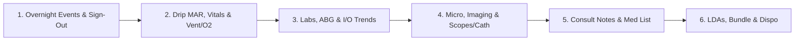

# MICU / CCU Chart-Checking Flow & Note Content Blueprint

This guide maps **what clinical information goes into every written section of the note**, structured in the exact order of an efficient **Epic ICU pre-rounding chart check** so nothing expected on rounds or in your program's output is missed.

---

## 1. Recommended Pre-Rounding Chart-Check Sequence

| Chart-Check Step | Where to Look in Epic | Feeds Which Note Sections |
| :--- | :--- | :--- |
| **1. Overnight Pass** | Rapid Response / Transfer notes, Overnight Nursing notes, Bedside procedures | `Major Events in Last 24 Hours`, `Subjective`, `Hospital Course` tail |
| **2. Support & Hemodynamics** | MAR Continuous Infusions, Vitals/MAP range, Flowsheets (Vent/BiPAP/HFNC, RASS, Swan/RHC) | `Major Events`, `Pulmonology`, `Cardiovascular`, `Neuro` |
| **3. Trends & Clearance** | 24h I/O + hourly UOP, BMP/Cr trend, CBC/Plt/Hgb drops, LFTs/Lactate, ABG/VBG | `Cardiovascular`, `Renal`, `Heme`, `GI`, `Pulmonology` |
| **4. Diagnostics** | Blood/Urine/Sputum Cx (hours negative!), Viral/Urinary Ags, CXR/CT, TTE, RHC, EGD | `ID`, `Pulmonology`, `Cardiovascular`, `GI` |
| **5. Regimen & Recs** | Active Scheduled Meds (Abx start/EOT dates, GDMT, steroids, insulin, VTE/GI PPX) + Consult notes | All Organ-System Narrative Paragraphs & Action Bullets |
| **6. Access & Safety** | Avatar/LDAs (A-lines, CVCs, Foley, tubes, wounds), Code Status, Case Mgmt notes | `ICU Bundle / Checklist`, `Dispo`, `Lines` |

---

## 2. Top-of-Note Information Checklist

### `Reason for ICU admission`
* **Check**: ED/Transfer note or ICU H&P.
* **Include**: Either the **acute transfer trigger** (`AMS`, `SOB`) or the **presenting instability triad** (`Syncope, AICD shocks, c/f mixed septic and cardiogenic shock`; `PE s/p Cardiac Arrest and Shock`).

### `Major Events in Last 24 Hours` (2–4 Bullets)
* **Check**: Overnight MAR changes, procedure/consult notes, STAT labs, nursing events.
* **Include ONLY high-signal shifts from the last 24h**:
  * ICU admission or airway/O2 escalation (`Admitted to MICU`, `On rescue BIPAP`).
  * Vasoactive or antiarrhythmic changes / inability to wean (`On vasopressin 0.03, unable to be weaned off`, `Midodrine increased to 10 mg TID`, `Amio gtt held by Cards`).
  * Completed procedures, scopes, or cath findings (`RHC completed showing elevated filling pressures`, `GI endoscopy in am... ENT repeat scoped without active bleeding`).
  * Acute lab drops with immediate workup (`Platelets dropped to 52, HIT ab and Hemolysis work up`) or newly positive cultures (`One blood culture bottle positive for CoNS`).
  * New exam red flags (`Concern for loss of cough reflex`) or critical LTACH/insurance deadlines.

### `Subjective` (1–4 Short Sentences)
* **Check**: Bedside look + nursing neuro/symptom charting.
* **If Intubated / Non-Verbal**:
  1. Airway + sedation state (`intubated via tracheostomy and sedated` / `somnolent`).
  2. Comfort / distress (`Appears comfortable, in no acute distress`).
  3. Arousal / interaction (`eyes open, responding to some questions` vs. `Does not respond to commands`).
* **If Awake / Verbal**:
  1. Overall feel (`feeling well this morning`).
  2. Primary ICU symptom (`no SOB` / chest pain).
  3. Appetite / PO intake (`eating well`) + 1 targeted symptom tied to active workup (`no loose stools`).

---

## 3. Organ-System Information Matrix (What Goes Into `Assessment & Plan`)

> [!TIP]
> You only need to write a detailed **Narrative Paragraph** for **active** systems. For stable chronic systems (like uncomplicated `Endo` or outpatient `GI`), just list the diagnosis and medication bullets; for completely inactive systems, either omit the header or write `No acute concerns`.

### 1. `Neuro` / `Neuro/Psych`
* **Problem Stack**: Encephalopathy/delirium, agitation, dementia/sundowning, stroke/seizure, focal weakness/numbness, or substance withdrawal (`SUD`).
* **Chart Facts to Include in Narrative**:
  * Current orientation (`A&O x0`, baseline) and how mentation changed after interventions (e.g., BiPAP, sedation hold).
  * Suspected driver (`2/2 hypercapnia`, septic/metabolic, withdrawal + `UDS` result).
  * Head imaging (`CTH unremarkable`) and prior confounding meds (`received lactulose earlier but no cirrhosis`).
* **Plan Bullets**:
  * Sedation drip & target (`precedex`, `maintain RASS 0 to -1`).
  * Held sedatives/antipsychotics + family wishes (`hold seroquel`, `hold sedative agents`).
  * Withdrawal monitoring or `PT/OT`.

### 2. `Pulmonology` / `Resp` / `Respiratory`
* **Problem Stack**: Acute (or acute-on-chronic) hypoxic/hypercapnic respiratory failure, vent/BiPAP status, pneumonia/COVID/viral infection, pleural effusions, pulmonary edema, PE (with risk class/PESI), chronic lung disease (`OSA not on CPAP`, COPD/ILD).
* **Chart Facts to Include in Narrative**:
  * **Baseline O2** (`home 2L NC`) vs. **decompensation trigger** (WOB, `ABG pH / pCO2`, airway protection, rescue BiPAP).
  * **Imaging & Pleural workup**: `CXR` / `CT thorax` findings (edema vs. consolidation vs. fibrosis) and bedside US pleural pocket tappability.
  * **Weaning trajectory**: Passing vs. failing `SBT` trials, secretion burden/bronch, or `Tracheostomy` date.
* **Plan Bullets**:
  * Exact respiratory support (`Vent settings` / `NIPPV:BiPAP: 20/5` / `HFNC; wean as tolerated` / `O2 pp`).
  * Weaning plan (`Plan for SAT/SBT` / `Sedation holds with PS trials`).
  * Nebs/clearance (`duoneb`, `hypersal`, `incentive spirometry`), respiratory steroids/antivirals (`decadron`, `remdesivir` + `EOT` date), and gas monitoring (`Serial VBGs` / `Monitor ABG` / `ABG PRN`).

### 3. `Cardiovascular`
* **Problem Stack**: Shock phenotype + stage (`cardiogenic [SCAI E] vs septic vs obstructive`), HFrEF/HFmrEF (with **exact `EF %` & etiology** `ICM`/`NICM`), arrhythmias (`AF RVR`, `VT/SVT` + `DCCV` or `ICD` status), `CAD` (`CABG` / `PCI` vessels & dates), troponin/demand ischemia, DVTs, `HTN`/`HLD`.
* **Chart Facts to Include in Narrative**:
  * **Hemodynamic arc**: Baseline BP (e.g., `runs 130-160 systolic`), fluid boluses/albumin given, pressor/inotrope history (what was weaned off + exact date `Off pressors since M/D`, what remains active), and `RHC`/Swan numbers (`CI`, `filling pressures`).
  * **Echo & Cardiology/EP input**: `TTE` EF/RV/valve findings, Cardiology/EP recs (ischemia eval needed vs. deferred, device interrogation/settings).
  * **Volume/Diuresis status**: Diuretic start date & net fluid goal.
* **Plan Bullets**:
  * Active pressors/inotropes/midodrine + **`MAP goal >60`** (and `hemodynamics Q4H` if Swan in place).
  * Active diuresis (`Bumex gtt at 1`, `furosemide 20 mg daily`), `Strict I&O`, `fluid restriction`.
  * Antiarrhythmics (`amiodarone`, `mexiletine`), anticoagulation (`heparin gtt` vs `Eliquis`), `Tele`.
  * Held vs. continued home cardiac meds (`hold home losartan`, `Lipitor`, `Plavix`, `Hydralazine/isordil`).
  * **Electrolyte targets**: `K >4, Mg >2` (or `K >4.5, Mg >2` with ventricular arrhythmias) + pending `f/u TTE` / `EKG` / cath.

### 4. `FEN/GI` / `GI`
* **Problem Stack**: GI bleed / gastritis, SBO/ileus, shock liver / congestive hepatopathy / cirrhosis, dysphagia / `PEG` tube, incidental hepatobiliary/pancreatic findings.
* **Chart Facts to Include in Narrative**:
  * Overt bleeding check (`melena`, `BRBPR`, `OG/NG output` character & volume, Hgb stability) + `EGD`/Surgery/GI recs.
  * Bowel decompression / tube patency (`small bowel f/t`, `KUB` for pain or G-tube check) and LFT trajectory (`Shock liver improving`).
  * Current tube-feed tolerance (`at trickle feed goal rate`).
* **Plan Bullets**:
  * Diet / enteral feed order (`Continue enteral trickle feeds`, `NPO`, conditional start `if OGT output < 450 cc`) + **free water flushes** (`fwf 350ml q4h`).
  * `Stress ulcer prophylaxis` (`IV Protonix 40 BID` / `PPI`).
  * `Bowel regimen` / `f/u BMs`, `Trend LFTs`, `f/u KUB`, `SLP` / consultant follow-up.

### 5. `ID`
* **Problem Stack**: Fever curve (`Fevers, resolving`), septic shock, specific confirmed/suspected infections (`ESBL PsA Pneumonia`, `COVID +`, `Rhinovirus`), leukocytosis, MDR history (`Hx ESBL UTI`).
* **Chart Facts to Include in Narrative**:
  * **Tmax & WBC/ANC context** (including non-infectious confounders like steroids).
  * **Source localization**: Pulmonary vs. urinary vs. line/bacteremia.
  * **Complete negative & positive micro ledger**: Blood cx (contaminant `CoNS` vs true, `ng 24h`), UA/UCx, sputum cx, respiratory viral panel, `Legionella/Strep` urinary Ag, `C. diff`, MRSA nares.
  * **Antibiotic timeline**: Prior courses + **exact completion dates** (`14-day meropenem completed M/D`).
* **Plan Bullets**:
  * Active antimicrobials with **explicit `EOT <date>`** (`Cw Rocephin 2 g EOT M/D`) or de-escalation plan.
  * Pending cultures to follow up (`f/u blood cx`, `f/u sputum cx`, `f/u ucx`, repeat cx).
  * Source control contingencies (`chest tube` if effusions worsen) + `F/u ID recs`.

### 6. `Renal, fluid, and electrolytes` / `Renal/Lytes`
* **Problem Stack**: `AKI` (with stage/status `- resolved` or `on CKD3` + etiology `2/2 ATN` / cardiorenal), `CRRT` / `ESRD`, acid-base (`HAGMA`), dysnatremias (`Hyponatremia`).
* **Chart Facts to Include in Narrative**:
  * **Baseline Cr vs. Today's Cr** (`Baseline Cr 1.8-2.0 now 2.18`).
  * Suspected etiology, `CRRT` start/stop status, and response to diuretic challenges (`Lasix 80 mg IV -> good UOP`).
* **Plan Bullets**:
  * `Monitor BMP and UOP` / hourly UOP / `CTM`.
  * Retention check (`Bladder scan/straight cath if retaining`) and `urine studies` contingency if Cr worsens.

### 7. `Heme` / `Heme/Onc`
* **Problem Stack**: Anemia (`AoCD`, acute blood loss), thrombocytopenia, coagulopathy / `DIC` / post-lytic oozing, pancytopenia / hematologic malignancy (`CLL`).
* **Chart Facts to Include in Narrative**:
  * Hgb/Plt/WBC trends, clinical oozing sites (`IV lines, nose/mouth`), and `HIT-ab` / `DIC` / `hemolysis` results.
  * Heme/Onc consultant recs (e.g., `BM biopsy deferred`, `IVIG`).
* **Plan Bullets**:
  * `Monitor CBC` + **explicit transfusion trigger** (`Transfuse if Hgb <8` or `<7`).
  * **Anticoagulation / VTE PPX hold rule** (`holding lovenox with plt 58, resume once improved`) + anemia labs (`iron panel, ferritin`).

### 8. `Endo`
* **Problem Stack**: `T2DM` (with `A1c` & date) / `steroid-induced hyperglycemia`, hypo/hyperthyroidism, adrenal insufficiency (`stress dose steroids`), gout.
* **Chart Facts to Include in Narrative**: Only needed for complex endocrine issues (e.g., `amiodarone-induced thyrotoxicosis` TSH/fT4 trends + Endo recs).
* **Plan Bullets**:
  * Basal + prandial + sliding scale insulin (`glargine QHS; SSI` / `NPH, lispro, SSI` + `hypoglycemia` protocol).
  * Thyroid/steroid doses (`levothyroxine`, `methimazole`, `prednisone`, `stress dose steroids`) + scheduled `TFT` rechecks.

---

## 4. Bottom Bundle, Lines, & `HOSPITAL COURSE` Update Check

Before signing or pending your note, verify these **five high-yield closing items**:
1. **Prophylaxis & Nutrition Trio**: `GI PPX` (`Protonix`/`PPI`), `VTE PPX` (`Heparin`/`Lovenox`—or explicitly `Held` + reason), and `Nutrition` (`NPO` / `NG Tube` / diet).
2. **Hidden Access Check**: Confirm whether the patient has an **arterial line (`A-line`)**, **midline**, **PICC**, or **dialysis catheter**—Epic's default `Lines:` dot-phrase frequently misses arterial lines and midlines!
3. **Code Status & MPOA Sync**: Verify your bottom checklist `Code Status` matches the top live order (`Full` vs. `DNR`), and record the `MPOA` name/relationship on complex ICU stays.
4. **`Dispo` & `Prognosis`**: Add facility/LTACH/insurance status on chronic ICU stays and a 1-word `Prognosis` (`Guarded`) if your template includes it.
5. **1–3 Sentence `HOSPITAL COURSE` Append**: Click the Hospital Course link and tack on **dated, telegraphic milestones** from the past 24h (`On M/D, ...`—pressor weans, line changes, completed antibiotic courses, major scopes/imaging, or transfer trigger).
