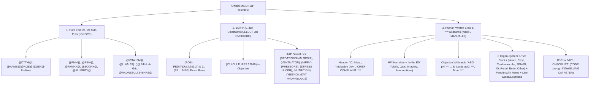

# MICU Initial H&P Master Playbook

> [!IMPORTANT]
> **Source-of-Truth Rule**: Every instruction, scaffold, and bot rule in this guide is locked strictly to the **official `Medicine Intensive Care History and Physical` Epic template**. The four attested resident notes are used solely to calibrate **writing style, clinical reasoning depth, shorthand, and word/sentence length** inside the template's exact slots.

**Table of Contents**
1. [Section 1: Official MICU Template Audit (Auto-Pulls vs. SmartLists vs. Manual Slots)](#section-1-official-micu-template-audit-auto-pulls-vs-smartlists-vs-manual-slots)
2. [Section 2: Exact Text Length & Quantitative Benchmarks](#section-2-exact-text-length--quantitative-benchmarks)
3. [Section 3: Pure Manual MICU H&P Scaffold (Official Template Skeleton)](#section-3-pure-manual-micu-hp-scaffold-official-template-skeleton)
4. [Section 4: Slot-by-Slot Instructions — How to Fill the Official MICU Template](#section-4-slot-by-slot-instructions--how-to-fill-the-official-micu-template)
5. [Section 5: Level of Clinical Reasoning Expected in MICU H&Ps](#section-5-level-of-clinical-reasoning-expected-in-micu-hps)
6. [Section 6: Formatting, Whitespace, & Punctuation Specification](#section-6-formatting-whitespace--punctuation-specification)
7. [Section 7: Language, Register Shifts, & Shorthand Lexicon](#section-7-language-register-shifts--shorthand-lexicon)
8. [Section 8: Copy-Paste MICU H&P Bot System Instructions](#section-8-copy-paste-micu-hp-bot-system-instructions)

---

## Section 1: Official MICU Template Audit (Auto-Pulls vs. SmartLists vs. Manual Slots)



### 1.1 Line-by-Line Template Boundary Table

| Official Template Section | Epic Auto-Populated (Ignore) | SmartLists `{...:ID}` (Click or Override) | What You Write Yourself |
| :--- | :--- | :--- | :--- |
| **Top Header** | `Date of Service: @DTTM@` | — | `ICU day:` (`1`), `Intubation Day:` (`1` or `N/A`), `CHIEF COMPLAINT: ***` (1–2 words) |
| **`HISTORY OF PRESENT ILLNESS`** | `@NAME@ is a @AGE@ @SEX@ ` prefix | — | Full HPI narrative continuing directly after `@SEX@ ` + the 4 `In the ED` rows (`Vitals:`, `Labs:`, `Imaging:`, `Interventions:`) |
| **Past / Family / Social / Allergies** | `@PMH@`, `@PSH@`, `@FAMHX@`, `@SOCHX@`, `@ALLERGY@` | — | **Nothing** *(auto-pulled)* |
| **`REVIEW OF SYSTEMS`** | — | `{ROS - PEDI/ADULT:20317}` *(note: template has duplicate `Review of Systems:` header—delete one)* | Click SmartList if verbal; overwrite with 1-line `Unable to obtain...` disclaimer if intubated or AMS |
| **`PHYSICAL EXAMINATION`** | `@VITALSM@` | 11 `{PE ... MEG:33369–33396}` rows (`Constitutional` $\rightarrow$ `Neuro`) | Click normal defaults + type abnormal bedside findings, tubes, incisions, and sedation/neuro state |
| **`Labs / Imaging / Micro`** | `@LLVAL24(...)@` 24h grid, `@RADRESULTS48HRS@` | `{ICU CULTURES:32049}` | Fill `ABG: pH: *** PCO2: *** PO2: *** HCO3: *** FiO2: ***` and `Lactic acid: ***, Time: ***` (or `N/A`); paste `TTE`/`RHC` if applicable |
| **`Assessment/Plan:`** | `@NAME@ is a @AGE@ @SEX@ admitted with: ` | `Sedation/Analgesia`, `Vent`, `NIPPV`, `Pressors`, `Stress ulcer ppx`, `Nutrition`, `Insulin drip`, `DVT ppx` | Diagnosis stack + reasoning paragraph + `- ` action bullets under all 8 headers (`Neuro`, `Resp`, `Cardiovascular`, `FEN/GI`, `ID`, `Renal`, `Endo`, `Other`) + `Rate: ***` & `Lines/Catheters: Insertion date: ***, Location: ***` |
| **`MICU CHECKLIST:`** | — | — | All 12 `***` rows (`CODE` through `INDWELLING CATHETER`) |

### 1.2 Three Epic Auto-Pull Blind Spots to Watch For
1. **OSH Transfers Print Blank `@PMH@` & Blank `@RADRESULTS48HRS@`**: Outside-hospital transfers arrive before Epic problem lists or UTMB PACS impressions exist (`has no past medical history on file`; `No final results containing an impression from the past 2 days were found.`). **Fix**: Put all known PMH in your HPI one-liner + A&P diagnosis stacks, and paste OSH CT/CXR impressions into `In the ED` $\rightarrow$ `Imaging:`.
2. **Cardiology Procedures Miss `@RADRESULTS48HRS@`**: `TTE` and `RHC` reports do not pull into radiology impressions—paste key echo/cath findings above `@RADRESULTS48HRS@` (and summarize in `Cardiovascular`).
3. **`{PE ... MEG}` Orientation Mismatch**: Clicking `Constitutional: alert and oriented x 4` while clicking `Neuro: alert and oriented x 3` (seen in Ex 1) creates an internal contradiction—always sync orientation/sedation across both rows.

---

## Section 2: Exact Text Length & Quantitative Benchmarks

Calibrated from the four attested H&Ps and mapped onto the official MICU H&P template slots:

| Official MICU Template Slot | Target Manual Length | Evidence Across Signed Notes | How Length Scales |
| :--- | :--- | :--- | :--- |
| **`ICU day:` / `Intubation Day:`** | **1 token each** | `1` · `6` · `N/A` | Integer day count, or `N/A` if non-intubated. |
| **`CHIEF COMPLAINT: ***`** | **1–2 words** | `SOB` · `AMS` · `Fatigue` · `facial swelling` | Bare symptom noun phrase or acronym; zero sentences, no period. |
| **`HPI` Narrative** *(above `In the ED`)* | **150–380 words** *(2–3 paragraphs)* | Fresh OSH admit: `152w` (+ `77w` ED block) · Complex transfers: `343–415w` | **150–200w** for fresh Day-1 ED/OSH admits; **300–380w** when summarizing a multi-day floor/surgical course prior to MICU transfer. |
| **`In the ED` Block** *(4 sub-lines)* | **50–85 words** *(+ pasted OSH imaging)* | Ex 4: `77w` manual + pasted CT/CXR impressions | 1 line for `Vitals`, 3–6 items for `Labs`, impression paste/summary for `Imaging`, 1 line for `Interventions`. |
| **`REVIEW OF SYSTEMS`** | **5–7 words** *(intubated/AMS)* or **30–95 words** *(verbal)* | Intubated/AMS: `5–7w` · Verbal: `31–94w` | Single-line disclaimer whenever intubated, sedated, or encephalopathic. |
| **`PHYSICAL EXAMINATION`** *(11 rows)* | **35–65 words** *(across active rows)* | Signed examples: `33–61w` total | 2–10 words per row (`Deferred` or `N/A` on `Rectal:` unless GI bleed). |
| **`ABG:` & `Lactic acid:` Lines** | **7–12 tokens** | `pH 7.39 / PCO2 33 / PO2 155` · `Lactate 0.97` | Exact numbers + timestamp (or `N/A` to clear `***`). |
| **`A&P` — Diagnosis Stack** | **12–21 lines total** *(1–6 per active system)* | Signed examples: `12–21` total diagnosis lines | Stack acute MICU diagnoses above chronic background conditions in each system. |
| **`A&P` — Reasoning Narratives** | **15–60 words per active system** *(115–360w total)* | PGY-1 single-issue admit: avg `21w` (`15–36w`) · Complex multi-organ MICU transfer: avg `51w` (`38–62w`) | **15–30w (1–3 sentences)** for straightforward single-etiology problems; **40–60w (3–6 sentences)** for shock, oliguric AKI, post-op abdomen, or diagnostic uncertainty. |
| **`A&P` — Action Bullets** | **16–36 bullets total** *(2–13 per active system)* | Signed examples: `16–36` total bullets | Heavy hemodynamic/shock systems take **6–13 bullets**; standard active systems take **2–6 bullets**; stable chronic systems take **1–2 bullets**. |
| **`MICU CHECKLIST:`** *(12 rows)* | **12–45 words total** *(1–5 words per row)* | Signed checklist: `9–12 rows`, `1–4w` per row | Short telegraphic nouns/statuses (`Full`, `PRVC`, `NPO`, `Pantoprazole`, `N/A`). |
| **TOTAL MANUAL WORD COUNT** | **~550–1,050 words** | Simple OSH admit: `~515w` · Complex MICU transfer: `~890–1,020w` | Scales directly with pre-MICU hospital stay length and number of failing organ systems. |

---

## Section 3: Pure Manual MICU H&P Scaffold (Official Template Skeleton)

Below is the **exact `Medicine Intensive Care History and Physical` template** with pure `@...@` auto-pulls removed so only the fields you write, click, or fill remain in exact template order:

```text
Medicine Intensive Care History and Physical

Date of Service: [@DTTM@ auto]
ICU day: [1]
Intubation Day: [1 OR N/A]

CHIEF COMPLAINT: [1-2 word symptom or acronym: SOB / AMS / facial swelling]

HISTORY OF PRESENT ILLNESS
[@NAME@ is a @AGE@ @SEX@] with a PMH significant for [key comorbidities w/ EF %, devices/stents/surgeries + dates, baseline AC] who [presents from ED / was transferred from OSH / was transferred from floor] for [acute syndrome]. [If intubated/AMS: Pt was intubated and sedated PTA, so history is obtained from medical records.] [2-5 sentences detailing acute symptom onset & progression OR original hospital presentation.]

[Paragraph 2 — Collateral & Med-Rec (60-80w on ED/OSH admits) OR Chronological Inpatient Course to Date (180-275w on floor/surgical transfers, ending with the acute trigger for MICU transfer).]

[Optional Paragraph 3 on Transfers (60-95w) — Immediate MICU bedside status today, current pressor/O2 needs, family bedside update, baseline mentation/mobility, prior wishes regarding HD/intubation.]

In the ED
Vitals: [BP X/Y, P X, RR X, T X, SpO2 X% on RA/O2 — or N/A if direct/floor transfer without ED stay]
Labs: [Key pertinent initial labs + pending blood/urine cultures, e.g., WBC X, Hgb X, Plt X, Cr X, K X, Lactate X]
Imaging: [Concise ED/OSH CXR, CT impressions — paste full OSH impressions here if not in UTMB PACS]
Interventions: [Airway/intubation, IV antibiotics, fluid resuscitation, pressors/drips started prior to MICU]

[Auto-Populated @PMH@, @PSH@, @FAMHX@, @SOCHX@, @ALLERGY@ — Ignore]

REVIEW OF SYSTEMS:
[If verbal: {ROS - PEDI/ADULT:20317} (+)/(-) systems | If intubated/AMS: "Unable to obtain 2/2 intubation and sedation." OR "Unable to assess given AMS"]

PHYSICAL EXAMINATION
[@VITALSM@ auto]
Constitutional: [e.g., intubated and sedated | awake, off sedation, NAD]
HEENT: [e.g., normocephalic atraumatic; ETT/NGT in place; moist/dry mucous membranes]
Neck: [e.g., supple, no JVD/lymphadenopathy — OR submandibular swelling/CVC site]
Resp: [e.g., clear to auscultation bilaterally | coarse breath sounds / crackles bilaterally on mechanical ventilation]
Cardio: [e.g., regular rate and rhythm, normal S1/S2, no murmurs, rubs, or gallops]
GI: [e.g., soft, non-distended, non-tender, +BS; surgical incisions C/D/I without bleeding/oozing]
GU: [e.g., Foley catheter / Purwick in place | no costovertebral tenderness]
Rectal: [Deferred — OR guaiac/tone findings if active GI bleed/neuro concern]
MSK: [e.g., normal range of motion, no gross deformity]
Integ: [e.g., warm and dry, no rash; note wounds/plaques/ecchymoses]
Neuro: [e.g., sedated on propofol | follows simple commands, non-verbal, no focal deficits]

Labs (pertinent only)/Imaging:
[Auto @LLVAL24(...)@ 24h Lab Grid — Ignore]

ABG: pH: [7.XX or N/A]  PCO2: [XX]  PO2: [XXX]  HCO3: [XX]  FiO2: [XX%]
Lactic acid: [X.XX or N/A], Time: [HHMM]

[Paste TTE / RHC summary here if performed; Auto @RADRESULTS48HRS@ & {ICU CULTURES:32049} follow]

Assessment/Plan:
[@NAME@ is a @AGE@ @SEX@ admitted with:]

Neuro
Sedation/Analgesia: {SEDATION/ANALGESIA:32044}
[Active encephalopathy / AMS 2/2 X / Sedated 2/2 intubation]
[Chronic neuro/psych condition]
[15-60w reasoning: arousal trajectory, CTH/culture rule-outs, sedation goal + "Will..." bridge.]
- [Drip titration / RASS goal OR Avoid sedating medications + Neuro checks]
- [Continue/hold home psych/neuro meds / PT/OT]

Resp
-Vent: {VENTILATOR:32048}
-NIPPV:{ NIPPV:32058}
[Acute hypoxic/hypercapnic respiratory failure 2/2 X OR Intubated 2/2 airway protection]
[Secondary lung dx: c/f HAP / pulmonary edema / OSA / COPD / sarcoidosis]
[15-60w reasoning: intubation/BiPAP trigger, cough reflex, CXR findings, volume vs infectious differential + "Will..." bridge.]
- [SBT as tolerated / BiPAP wean / O2 per protocol]
- [Duoneb / Pulm toilet / IS / F/u CXR / Abx per ID]

Cardiovascular
Pressors (mcg/kg/min): {PRESSORS:32059}
[Shock phenotype (e.g., Shock, likely septic vs hypovolemic) OR Acute on Chronic HFrEF (EF X%)]
[CAD s/p PCI/CABG w/ dates / Afib on AC / HTN]
[20-60w reasoning: OSH/floor BP vs current BP, pressor/inotrope requirement, EF/RHC/volume status, shock differential + "Will..." bridge.]
- [Wean pressor for MAP >65 OR diuretic gtt + urine Na check]
- [Anticoagulation / antiplatelets / statin]
- [Hold vs continue home antihypertensives/GDMT + inline reason]
- [Telemetry / Strict I&O / Keep K>4, Mg>2]

FEN/GI
Stress ulcer prophylaxis: {STRESS ULCER PROPHYLAXIS:32045}
Nutrition: {NUTRITION:32047}  Rate: [XX or N/A]ml/hr.
[Active GI/surgical/hepatic issue — OR "No acute concerns."]
[If active: 30-60w OR/EBL/wound/BM/KUB/dysphagia status + "Will..." bridge.]
- [NPO / NGT to LIWS / Start trickle feeds / Diet]
- [PPI daily / Bowel regimen / General surgery or SLP recs]

ID
[Confirmed or suspected infection + source (e.g., Ludwig's angina / c/f HAP)]
[Leukocytosis / Immunocompromised or post-splenectomy status]
[30-55w reasoning: Tmax, WBC (noting if steroid-related), localizing signs/OSH CT, culture status, specialist input.]
- [F/u blood & urine cultures (specify OSH and UTMB), urinary Ags, respiratory viral panel]
- [Empiric/targeted IV antibiotics]
- [Consult ID or source-control surgical service (OMFS / Gen Surg)]

Renal
[Oliguric AKI on CKD c/f ATN / Acid-base or electrolyte disorder]
[15-60w reasoning: Baseline Cr vs current Cr, UOP, prior Lasix/fluid response, Nephro input, HD GOC alignment.]
- [Monitor BMP and UOP / Replete electrolytes PRN]
- [UA + urine studies contingency / Renally dose meds / Avoid NSAIDs, ACEi/ARB, IV contrast]

Endo
Insulin drip: {YES/NO:63} Rate: [XX or N/A]IU/hr. BG Range:[140-180 or N/A]mg/dL
[T2DM / Steroid-induced hyperglycemia / Thyroid disease — OR "No acute concerns"]
[If active: 15-45w home regimen, A1c/TSH status, Endo input.]
- [SSI or basal-bolus insulin; hold home PO antihyperglycemics]
- [F/u A1c / TSH w/ reflex to FT4 / home steroid or thyroid doses]

Other
DVT prophylaxis: {DVT PROPHYLAXIS:32046}
Lines/Catheters:
Insertion date: [M/D/YY], Location: [Device + vessel/laterality, e.g., R IJ CVC / PIV LUE]
Insertion date: [M/D/YY], Location: [Device + vessel/laterality, e.g., L radial A-line / Foley]
[Heme/Onc or systemic diagnoses: Anemia / Thrombocytopenia / ITP / Sarcoidosis]
[10-50w stability, bleeding check, Heme recs, MPOA/Prognosis/Palliative notes if applicable.]
- [Monitor CBC / Iron studies / Heme or Palliative recs]
- [Transfuse PRBC if Hgb <7 (or <8); Plt transfusion threshold if thrombocytopenic]
- [MPOA: Name (relationship) | Prognosis: guarded/serious]

MICU CHECKLIST:

CODE: [Full / DNR/DNI]
VENT: [Mode/settings e.g. PRVC OR BiPAP OR N/A]
FEEDING/FLUIDS: [NPO / Enteral feeds at X mL/hr / Diet / IVF]
ANALGESIA: [Fentanyl gtt / Tylenol PRN / None]
SEDATION: [Propofol / Precedex / None]
THROMBOPROPHYLAXIS: [Lovenox / Heparin SQ / SCDs only (contraindicated 2/2 plt) / Therapeutic AC]
HEAD-OF-BED ELEVATION: [>30 degrees / Yes]
ULCER (STRESS) PPX: [Pantoprazole / Famotidine / Not indicated]
GLYCEMIC CONTROL: [SSI / Basal-bolus + SSI / Insulin gtt / N/A]
SBT/SEDATION VACATION: [Daily per protocol / SBT as tolerated / N/A]
BOWEL REGIMEN: [Senna/Miralax / PRN / Held]
INDWELLING CATHETER: [Foley in place / Purwick / None]
```

---

## Section 4: Slot-by-Slot Instructions — How to Fill the Official MICU Template

### 4.1 Top Metadata & `CHIEF COMPLAINT: ***`
* **`ICU day:`**: Enter `1` on the initial MICU admission or transfer note.
* **`Intubation Day:`**: Enter `1` if intubated in the ED/OSH or on arrival (or cumulative days if intubated earlier on another unit); enter `N/A` if not intubated.
* **`CHIEF COMPLAINT: ***`**: Enter **1–2 words** (`SOB`, `AMS`, `Fatigue`, `facial swelling`). Never use a full sentence or period.

### 4.2 `HISTORY OF PRESENT ILLNESS` & `In the ED`
Start typing immediately after the auto-populated `@NAME@ is a @AGE@ @SEX@ ` stub, adapting to the two MICU arrival pathways:

1. **Pathway A — ED or Outside-Hospital (OSH) Arrival to MICU** *(~220–260 words total + OSH imaging)*:
   * **Paragraph 1 (75–90w)**: Complete the one-liner (`with a PMH significant for [...] who presents from the ED / was transferred from [OSH] for c/f [diagnosis].`). If intubated or altered, add the source disclaimer (`Pt was intubated and sedated PTA, so history is obtained from medical records.`), followed by 3–4 short sentences on symptom timeline and pertinent negatives (`denied CP, abd pain, NVD`).
   * **Paragraph 2 (60–75w)**: Family/spouse collateral and home medication reconciliation (`Spoke with patient's [relation] who states...` — prior episodes/surgeries, recent steroids, home medication classes, explicitly noting if exact doses are unknown).
   * **`In the ED` Sub-Block (70–85w + OSH imaging)**:
     * `Vitals:` Single-line initial ED/OSH vitals (`BP 158/92, P 81, RR 17, T 98.2F, SpO2 99% on RA`).
     * `Labs:` Key abnormal ED/OSH labs + pending cultures (`WBC 8.19, Plt 166, K 3.2, Lactic acid 0.97; blood cultures pending`).
     * `Imaging:` Concise UTMB ED reads, or **verbatim pasted OSH CT/CXR impressions** (essential because `@RADRESULTS48HRS@` cannot pull outside-hospital scans).
     * `Interventions:` IV antibiotics, fluids, pressors, and intubation indication (`IV Zosyn, IVF. Electively intubated for airway protection.`).

2. **Pathway B — Intra-Hospital Floor / Surgical / Trauma Transfer to MICU** *(~350–415 words total)*:
   * **Paragraph 1 (50–85w)**: One-liner (`with a PMH significant for [EF%, stents/surgeries, AC] who originally presented on [M/D] for [initial issue]...`, plus any discharge within the prior 1–2 weeks).
   * **Paragraph 2 (200–275w, formal past tense)**: Chronological synthesis of the hospital stay so far—initial presentation/labs/CT, dated procedures or OR findings (`ex-lap on M/D with EBL 1-1.2L`, `RHC on M/D`), specialist recommendations (ID, Nephro, Heme, Cards), **ending with the acute decompensation that triggered MICU transfer**.
   * **Paragraph 3 (65–95w, bedside prose)**: Current MICU bedside status today (`Today, patient was able to nod to questions...`), current drip rate (`low-dose levophed at 0.03`), family bedside update (baseline mentation/ambulation, prior statements on HD/code status), or a 1-sentence negative ROS if awake/verbal.
   * **`In the ED` Sub-Block**: Either summarize the **original admission ED/pre-transfer rapid-response** vitals/labs/imaging/interventions concisely in the 4 slots, OR enter `See hospital course above (floor-to-MICU transfer)` if ED data is remote/non-pertinent so no empty labels dangle.

### 4.3 `Review of Systems:` & `PHYSICAL EXAMINATION`
* **Duplicate ROS Header Cleanup**: Delete one of the two stacked `Review of Systems:` / `REVIEW OF SYSTEMS:` headers in the template.
  * *If intubated/sedated/AMS*: Replace `{ROS - PEDI/ADULT:20317}` with `Unable to obtain 2/2 intubation and sedation.` or `Unable to assess given AMS`.
  * *If awake & verbal*: Complete `{ROS - PEDI/ADULT:20317}` ensuring positive symptoms match the HPI.
* **11-Row `{PE ... MEG}` Exam**: Use the SmartLists for normal systems and overwrite abnormal/ICU-specific findings directly:
  * `Constitutional:` Arousal + sedation + distress (`intubated and sedated` | `awake, off sedation, NAD`).
  * `HEENT:` / `Neck:` Oral/nasal airways (`ETT`, `NGT in place`), mucous membranes, submandibular/neck findings or IJ CVC site.
  * `Resp:` Auscultation (`coarse lung sounds bilaterally`, `crackles to bilateral lungs`, `CTAB`).
  * `Cardio:` Rate, rhythm, murmurs (`bradycardic, regular rhythm`, `RRR, normal S1/S2`).
  * `GI:` Softness, distension, tenderness, bowel sounds, plus surgical wounds/drains (`abdominal incision C/D/I without signs of bleeding or oozing`).
  * `GU:` / `Rectal:` Document `Foley in place` / `Purwick` under `GU:`; mark `Deferred` on `Rectal:` unless performed (e.g., GI bleed).
  * `MSK:` / `Integ:` / `Neuro:` Edema, wounds, rashes/plaques, and exact command-following/sedation state (must match `Constitutional:`).

### 4.4 Manual Objective Wildcards (`ABG:` & `Lactic acid:`)
* Always clear the `***` wildcards below the 24h lab grid:
  * `ABG: pH: 7.39  PCO2: 33  PO2: 155  HCO3: 20  FiO2: 60%` *(or `ABG: N/A` if none obtained)*.
  * `Lactic acid: 0.97, Time: 0024` *(or `Lactic acid: N/A` if not drawn)*.

### 4.5 `Assessment/Plan:` — Filling All 8 Official Template Sections
Leave `@NAME@ is a @AGE@ @SEX@ admitted with:` as a clean colon lead-in (do not repeat the HPI one-liner). Under each of the 8 headers, resolve the built-in SmartList/wildcard line and write your **3-Tier Organ-System Block** (`Stacked Diagnoses` $\rightarrow$ `Reasoning Narrative` $\rightarrow$ `- Action Bullets`) with **zero blank lines** inside the system:

1. **`Neuro`** *(built-in: `Sedation/Analgesia: {SEDATION/ANALGESIA:32044}`)*:
   * Stack active encephalopathy/delirium/sedation (`AMS 2/2 suspected TME` or `Sedated 2/2 intubation`) + baseline neuro/psych diagnoses (`Anxiety`, `Stroke`).
   * Narrative: Mentation trajectory, focal deficit check, `CTH`/culture rule-outs, sedation rationale.
   * Bullets: Drip titration/RASS goal OR `- Avoid sedating medications` + `- Neuro checks`, home psych med hold/continuation (`- c/w home sertraline`), `- PT/OT`.
2. **`Resp`** *(built-in: `-Vent: {VENTILATOR:32048}` / `-NIPPV:{ NIPPV:32058}`)*:
   * Stack acute respiratory failure + etiology (`AHRF requiring intubation` / `Intubated 2/2 airway protection`) + parenchymal/chronic lung disease (`c/f HAP`, `OSA not on CPAP`, `Hx pulmonary sarcoidosis`).
   * Narrative: Intubation/BiPAP trigger, cough reflex, `CXR` findings, volume vs. infectious differential.
   * Bullets: Complete `-Vent:` / `-NIPPV:` (mark `N/A` or remove unused modality), `- SBT as tolerated` or `- O2 per protocol`, `- Duoneb` / `- Pulm toilet` / `- IS`, `- F/u CXR`, `- Abx per ID section`.
3. **`Cardiovascular`** *(built-in: `Pressors (mcg/kg/min): {PRESSORS:32059}`)*:
   * Stack shock phenotype (`Shock, likely septic vs hypovolemic`) or HF (`Acute on Chronic HFrEF EF X%`), `CAD s/p PCI/CABG (date)`, arrhythmias/AC, `HTN`.
   * Narrative: OSH/floor BP vs. current BP, pressor/inotrope course, `TTE`/`RHC` EF & filling pressures, shock/volume differential, diuretic or weaning plan.
   * Bullets: Pressor wean + `MAP >65` goal OR diuretic gtt + `3h urine Na` check, AC bridge/dose adjustment, home cardiac med holds (`- Hold home metoprolol given shock`, `- Hold all GDMT`) vs. continuations (`Plavix`, `statin`), `- Telemetry`, `- Strict I&O`, `- Keep K>4, Mg>2`.
4. **`FEN/GI`** *(built-in: `Stress ulcer prophylaxis: {:32045}` & `Nutrition: {:32047}  Rate: ***ml/hr.`)*:
   * Clear `Rate: ***ml/hr.` (`N/A` if `NPO` or oral diet; numeric rate if tube feeds).
   * If active GI/hepatic/surgical issue: stack diagnoses (`SBO s/p ex lap`, `Portal HTN`, `Dysphagia`), summarize OR/EBL/wound/BM/`KUB` status, and add bullets (`- NGT in place, LIWS`, `- Start trickle feeds if okay with surgery`, `- Bowel regimen`, `- General surgery / SLP recs`). If inactive: write `No acute concerns.`
5. **`ID`** *(pure free text)*:
   * Stack active/suspected infections (`Ludwig's angina`, `HAP`, `Potential Infection`), `Leukocytosis`, and host risk (`Hx of splenectomy`).
   * Narrative: Fever curve, `WBC` (noting if steroid-induced), localizing exam/OSH CT findings, negative/pending cultures, antibiotic toxicity review (e.g., cefepime vs. baseline AMS), ID consult input.
   * Bullets: `- F/u blood cultures (from OSH and UTMB), urine culture`, urinary antigens/viral panel, active IV antibiotics (`- c/w Zosyn`; `- Vanc, cefepime, flagyl`), source-control consult (`- consult OMFS, appreciate recommendations`).
6. **`Renal`** *(pure free text)*:
   * Stack `Oliguric AKI on CKD c/f ATN`, acid-base (`NAGMA`/`HAGMA`), and electrolyte disorders (`Hypokalemia`).
   * Narrative: `Baseline Cr X now Y` (or OSH K/Cr), `UOP`, response to prior Lasix/fluid trials, Nephrology involvement, and prior patient wishes regarding HD if applicable.
   * Bullets: `- Monitor BMP and UOP`, `- Replete electrolytes PRN`, `- UA w/ microscopy` / `- Urine studies` contingency, `- Renally dose medications`, `- Avoid NSAIDs, ACEi/ARB, and IV contrast`.
7. **`Endo`** *(built-in: `Insulin drip: {YES/NO:63} Rate: ***IU/hr. BG Range:***mg/dL`)*:
   * Select `Yes`/`No` for `Insulin drip:` and clear `Rate:`/`BG Range:` (`N/A` when not on insulin gtt).
   * Stack `T2DM`, `Steroid-induced hyperglycemia`, or `Thyroid disease` (or `No acute concerns`), note home meds & unknown `A1c`/`TSH`, and add bullets (`- Hold home PO antihyperglycemics`, `- SSI` or basal-bolus, `- F/u A1c`, `- F/u TSH w/ reflex to FT4`).
8. **`Other`** *(built-in: `DVT prophylaxis: {:32046}` & `Lines/Catheters: Insertion date: ***, Location: ***`)*:
   * **Use `Other` for Heme/Onc, Systemic/Autoimmune conditions, and MPOA/GOC**: Stack `Anemia`, `ITP` / `Thrombocytopenia`, `DVT/PE hx`, or `Sarcoidosis` + brief narrative + transfusion thresholds (`- Transfuse PRBC if Hgb <7.0 [or <8.0]; Plt <10 or <20 w/ active bleeding`), Heme/Palliative recs, and `MPOA` / `Prognosis` if not documented elsewhere.
   * Fill `DVT prophylaxis:` SmartList and populate every active line under `Lines/Catheters:` (`Insertion date: M/D/YY, Location: PIV LUE`; add/delete rows to match active CVCs, A-lines, PIVs, and Foleys).

### 4.6 `MICU CHECKLIST:` — Filling All 12 Bottom Wildcards
Fill every `***` with a concise **1–5 word status** so zero wildcards remain at signing:

| Checklist Key | Intubated / Shock Example | Non-Intubated Transfer Example |
| :--- | :--- | :--- |
| `CODE:` | `Full` *(or `DNR/DNI`)* | `Full` *(or `DNR/DNI`)* |
| `VENT:` | `PRVC, Vt 400, PEEP 5, FiO2 60%, RR 16` | `N/A` *(or `BiPAP` / `HFNC`)* |
| `FEEDING/FLUIDS:` | `NPO` *(or `Tube feeds at X mL/hr`)* | `NPO strict` *(or `Cardiac diet`)* |
| `ANALGESIA:` | `Fentanyl gtt` | `Tylenol PRN` |
| `SEDATION:` | `Propofol` *(or `Precedex`)* | `None` |
| `THROMBOPROPHYLAXIS:` | `Lovenox` *(or `Heparin SQ`)* | `Contraindicated (thrombocytopenia); SCDs` *(or `Heparin gtt`)* |
| `HEAD-OF-BED ELEVATION:` | `>30 degrees` | `>30 degrees` |
| `ULCER (STRESS) PPX:` | `Pantoprazole` | `Pantoprazole` *(or `Not indicated`)* |
| `GLYCEMIC CONTROL:` | `SSI` *(or `Insulin gtt`)* | `Lispro, NPH, SSI` *(or `SSI`)* |
| `SBT/SEDATION VACATION:` | `Daily per protocol / SBT as tolerated` | `N/A` |
| `BOWEL REGIMEN:` | `Senna, Miralax` | `Held (post-op SBO)` *(or `PRN`)* |
| `INDWELLING CATHETER:` | `Foley in place` *(or `Purwick`)* | `Foley in place` *(or `None`)* |

---

## Section 5: Level of Clinical Reasoning Expected in MICU H&Ps

Across the signed notes, residents avoid textbook essays and instead demonstrate reasoning through **five concrete clinical moves**:

1. **Explicit Differential Framing & Probability Weighing**:
   * Pairs competing drivers with `likely X vs Y` (`Shock, likely septic vs hypovolemic`) or flags secondary contributors that still require treatment (`Hypoxia likely 2/2 heart failure and volume overload but can not rule out infection as contributing. Will treat heart failure and infection as below.`).
   * Documents why coverage continues even when probability drops (`HAP thought to be less likely given imaging M/D, however, ID recommending continued broad spectrum coverage.`).
2. **Medication-Reconciliation & Iatrogenic Attribution**:
   * Catches outpatient med collisions (`concurrent losartan 25 mg and lisinopril 10 mg, plus Lasix 40 mg`), attributes non-infectious lab shifts (`leukocytosis likely 2/2 steroids and no fever`), and uses timeline logic to evaluate drug toxicity (`AMS was present prior to admission and unlikely affected by cefepime`).
3. **Baseline-to-Current Quantitative Anchoring**:
   * Always contrasts current values against baseline or OSH numbers: `Baseline Cr 1.8-2.0 now 2.41`, `Cr 3.6 from baseline 0.9`, `BP elevated to systolic of 200's at OSH. Currently 124/92.`, `home SBP readings as low as the 60s`.
4. **Diagnostic-Therapeutic Contingency Loops (`If X -> Then Y`)**:
   * Builds physiological checkpoints into plan bullets (`- Bumex gtt at 0.5; after being on bumex gtt for 3 hours check urine sodium`; `- If does not improve with aggressive diuresis will check urine studies`; `- Defer staged PCI until renal function and hemodynamics improve`).
5. **Early Trajectory & Goals-of-Care Alignment**:
   * Surfaces family collateral on baseline function and life-support preferences on Day 1 (`Unclear GOC should HD be indicated as patient reportedly has mentioned not wanting HD previously`; `Given persistent pressor use, declining UOP, and refractory ITP, palliative care consulted to aid on GOC`).

---

## Section 6: Formatting, Whitespace, & Punctuation Specification

* **Zero Blank Lines Inside an A&P System**: Under `Neuro`, `Resp`, `Cardiovascular`, `FEN/GI`, `ID`, `Renal`, `Endo`, and `Other`, keep the built-in template line(s), `Diagnosis Stack`, `Reasoning Narrative`, and `- Action Bullets` flush on consecutive lines with **0 blank lines** between them. Leave **1–2 blank lines** between organ systems.
* **Diagnosis Stack**: Plain unindented lines, Sentence case (or short Title Case), **no `#`**, no bullets, no trailing periods, ordered **most acute $\rightarrow$ chronic**. Link etiology via `2/2` and differentials via `c/f` or `vs`.
* **Action Bullets**: Prefix with `- `, **omit trailing periods** (~98%), join primary orders to titration rules with `;` (`- BiPAP; wean as tolerated`), and indent nested sub-bullets with **12–15 spaces + `- `**. Initial capitalization is relaxed (`- c/w Zosyn` alongside `- Monitor BMP`).
* **Structural Differences vs. Daily MICU Progress Notes**:
  * **No** `Major Events in Last 24 Hours` section (events belong in `HPI` + `In the ED`).
  * **No** `Subjective` header (bedside symptoms/arousal belong in the final `HPI` paragraph).
  * **No** bottom `HOSPITAL COURSE:` block below the signature.

---

## Section 7: Language, Register Shifts, & Shorthand Lexicon

A MICU H&P shifts cleanly across **three linguistic registers** from top to bottom:

| Register | Template Location | Sentence Mechanics | Verbatim Example |
| :--- | :--- | :--- | :--- |
| **1. Formal Past-Tense Synthesis** | `HPI` Paragraphs 1–2 (One-Liner + Pre-MICU Course) | Complete sentences, semicolons joining complex clauses, explicit `M/D` dates, OR `EBL`, consultant attributions. | *"She underwent emergent exploratory laparotomy and small bowel resection for hemorrhagic ischemic necrosis of a jejunal closed loop caused by adhesions...; EBL 1-1.2L."* |
| **2. Clipped Telegraphic Prose** | `HPI` Bedside Update & `A&P` Reasoning Narratives | Drops `"Patient"` subject (`Underwent ex lap...`, `Remains afebrile`), drops `is/was` copulas (`CTH on admission negative`, `Blood cx negative`), uses `"with"` for verbs (`CXR with volume overload`), **zero `I`/`we`**, closes with `"Will [verb]..."`. | *"Patient with continued AMS following ex lap and extubation, however, mentation improving this morning. Will continue to monitor. No focal neuro defects appreciated, CTH on admission negative."* |
| **3. Compressed Clinical Shorthand** | `In the ED`, `Exam`, `A&P` Bullets, & `MICU CHECKLIST` | High acronym density, noun-only med lines, inequality targets, zero articles. | `Pt was intubated and sedated PTA` · `NGT in place, LIWS` · `- Keep K>4, Mg>2` · `- F/u TSH w/ reflex to FT4` |

### Core MICU H&P Shorthand
* **Arrival & Course**: `PTA` (prior to arrival), `OSH` (outside hospital), `s/p` (status post), `2/2` (secondary to), `c/f` (concern for), `f/u` (follow up), `w/` / `wo` (with / without).
* **Exam & Devices**: `NAD` (no acute distress), `CTAB` (clear to auscultation bilaterally), `RRR` (regular rate/rhythm), `C/D/I` (clean, dry, intact), `LIWS` (low intermittent wall suction).
* **Plan & Management**: `C/w` / `c/w` (continue with), `CTM` (continue to monitor), `GDMT` (guideline-directed medical therapy), `GOC` (goals of care), `TME` (toxic-metabolic encephalopathy), `SBT` (spontaneous breathing trial), `PRVC` (pressure-regulated volume control).

---

## Section 8: Copy-Paste MICU H&P Bot System Instructions

````markdown
You are a MICU clinical documentation assistant filling the manually authored fields of the official Epic `Medicine Intensive Care History and Physical` template. The official MICU H&P template is your strict structural source of truth.

### 1. TEMPLATE FIDELITY & AUTO-POPULATED BOUNDARIES
- Preserve the exact section order and headers of the official `Medicine Intensive Care History and Physical` template:
  1. Header: `ICU day:`, `Intubation Day:`, `CHIEF COMPLAINT:`
  2. `HISTORY OF PRESENT ILLNESS` (continuing `@NAME@ is a @AGE@ @SEX@ `) + `In the ED` (`Vitals:`, `Labs:`, `Imaging:`, `Interventions:`)
  3. `REVIEW OF SYSTEMS:`
  4. `PHYSICAL EXAMINATION` (`Constitutional`, `HEENT`, `Neck`, `Resp`, `Cardio`, `GI`, `GU`, `Rectal`, `MSK`, `Integ`, `Neuro`)
  5. Manual Objective lines: `ABG: pH: ... PCO2: ... PO2: ... HCO3: ... FiO2: ...` and `Lactic acid: ..., Time: ...` (plus `TTE`/`RHC` paste if provided)
  6. `Assessment/Plan:` (`@NAME@ is a @AGE@ @SEX@ admitted with:`) -> `Neuro`, `Resp`, `Cardiovascular`, `FEN/GI`, `ID`, `Renal`, `Endo`, `Other` (retaining each header's built-in sedation, vent/NIPPV, pressor, ulcer/nutrition rate, insulin drip, DVT ppx, and `Lines/Catheters: Insertion date / Location` lines)
  7. `MICU CHECKLIST:` (all 12 rows: `CODE`, `VENT`, `FEEDING/FLUIDS`, `ANALGESIA`, `SEDATION`, `THROMBOPROPHYLAXIS`, `HEAD-OF-BED ELEVATION`, `ULCER (STRESS) PPX`, `GLYCEMIC CONTROL`, `SBT/SEDATION VACATION`, `BOWEL REGIMEN`, `INDWELLING CATHETER`)
- Do NOT generate Epic auto-populated blocks (`@DTTM@`, `@PMH@`, `@PSH@`, `@FAMHX@`, `@SOCHX@`, `@ALLERGY@`, `@VITALSM@` tables, `@LLVAL24@` 24h lab grids, `@RADRESULTS48HRS@`, or `{ICU CULTURES}`). Exception: On OSH transfers, write known PMH into the HPI one-liner + A&P stacks and paste OSH CT/CXR impressions into `In the ED` -> `Imaging:`.
- Do NOT output `#` diagnosis prefixes or daily-progress-note sections (`Major Events in Last 24 Hours`, `Subjective`, bottom `HOSPITAL COURSE`).
- Wildcard rule: Never invent clinical values, dates, drip rates, line dates, or MPOA names. Use `N/A` where a built-in numeric prompt is inactive (e.g., `Nutrition Rate: N/A` when NPO; `Insulin drip: No, Rate: N/A`; `Intubation Day: N/A`), and insert `***` whenever a required clinical fact is missing from the input.

### 2. LENGTH & CONTENT FORMULAS BY SLOT
- `CHIEF COMPLAINT:`: 1-2 words (`SOB`, `AMS`, `facial swelling`), no period.
- `HISTORY OF PRESENT ILLNESS`:
  - **ED / OSH Arrival (~150-190w narrative + 50-85w `In the ED` block)**: P1 one-liner + history-limitation clause if intubated/AMS (`Pt was intubated and sedated PTA, so history is obtained from medical records.`) + symptom timeline/negatives -> P2 family collateral & home med classes -> `In the ED` (`Vitals:`, `Labs:`, `Imaging:`, `Interventions:`).
  - **Intra-Hospital Transfer (~300-380w narrative + concise `In the ED` / pre-transfer summary)**: P1 one-liner + original presentation -> P2 formal past-tense hospital course (admission workup, dated OR/cath/procedures w/ EBL, specialist recs, ending with the MICU transfer trigger) -> P3 bedside status today, active pressor/O2 level, family collateral (baseline mentation/mobility, prior HD/code wishes), or 1-sentence negative ROS if verbal.
- `REVIEW OF SYSTEMS:`: If intubated/sedated/AMS, write `Unable to obtain 2/2 intubation and sedation.` or `Unable to assess given AMS`. If verbal, list concise `(+)/(-)` systems matching the HPI.
- `PHYSICAL EXAMINATION`: Concise findings across the 11 template rows (35-65w total); ensure `Constitutional` and `Neuro` orientation/sedation match; mark `Rectal: Deferred` unless performed.

### 3. 8-SYSTEM A&P ARCHITECTURE, CLINICAL REASONING, & VOICE
- Leave `@NAME@ is a @AGE@ @SEX@ admitted with:` bare after the colon.
- ZERO BLANK LINES inside each of the 8 organ systems: keep the built-in template line(s), plain Diagnosis lines (sorted acute -> chronic, no `#`, no periods), Clipped Reasoning Narrative (15-30w for simple single-etiology issues; 40-60w for shock, oliguric AKI, post-op abdomen, or multi-factorial transfers), and `- ` Action Bullets (no periods; `;` for order + titration; 12 spaces + `- ` for sub-bullets) flush on consecutive lines. Separate systems with 1 blank line.
- Place Heme/Onc (`Anemia`, `Thrombocytopenia`/`ITP`, transfusion thresholds), systemic autoimmune diseases, active `Lines/Catheters` (`Insertion date: M/D/YY, Location: ...`), and `MPOA`/`Prognosis` under `Other`.
- Reasoning must-haves: Weigh competing etiologies (`likely X vs Y`, `cannot rule out Z`), flag med-rec/iatrogenic drivers (ACEi+ARB+diuretic AKI, steroid leukocytosis, neurotoxic abx vs baseline AMS), anchor acute values to baseline/OSH (`Baseline Cr X now Y`), include `if/then` checkpoints (`check urine Na at 3h`), and surface GOC/HD wishes early.
- Voice: Never use `I` or `we`. Use formal past tense in HPI P1-P2, clipped pro-drop/copula-drop prose in HPI bedside & A&P narratives (`CXR with volume overload.`, `CTH negative.`, `Will monitor...`), and crisp 1-5 word entries across all 12 `MICU CHECKLIST:` lines.
````


---

## Section 9: Daily MICU Progress Note Add-On

Added 2026-11-15 from the progress-note package supplied on November 14. Sections 1-8 above are preserved as supplied. This section adds the daily progress-note mode; it does not replace the initial H&P.

### 9.1 Which instructions apply

The H&P source-of-truth rule and Section 8 apply to the **initial MICU H&P only**. For a **daily MICU progress note**, use this section and its progress-note prompt. Do not run both output scaffolds together.

| Component | Initial MICU H&P | Daily MICU progress note |
| :--- | :--- | :--- |
| Opening | ICU day, Intubation Day, CHIEF COMPLAINT | Reason for ICU admission; retain native auto-populated metadata |
| Clinical timeline | HPI, pre-transfer course, In the ED | Major Events in Last 24 Hours above Subjective |
| Bedside report | HPI bedside update, ROS, 11 exam rows | Short Subjective; manual exam findings in the existing Objective section when supplied |
| A/P lead-in | Preserve the template's demographic colon lead-in | Omit the empty demographic stub |
| Organ-system headings | Neuro, Resp, Cardiovascular, FEN/GI, ID, Renal, Endo, Other | Neuro, Pulmonology, Cardiovascular, FEN/GI, ID, Renal, fluid, and electrolytes, Endo, Heme/Onc |
| Heme/Onc | Under Other | Dedicated Heme/Onc block |
| Inactive systems | Retain the official H&P's eight headings | Follow the progress-note rule: compact block, supported No acute concerns, or omission |
| Footer | All 12 MICU CHECKLIST rows | ICU Bundle with prophylaxis, nutrition, surrogate, disposition and prognosis |
| Hospital course | Pre-MICU course belongs in HPI; no bottom HOSPITAL COURSE | Bottom HOSPITAL COURSE with dated daily updates |
| Length | H&P slot benchmarks in Section 2 | Progress-note slot guidance below; do not apply H&P word counts |
| Nested action bullets | Section 8 specifies 12 spaces | Progress-note prompt specifies 14 spaces |

Both modes use plain diagnosis stacks without # prefixes, acute-to-chronic ordering, concise reasoning, hyphenated action bullets, and no blank lines within an organ-system block. Keep ID after FEN/GI. DocuAid blocks are omitted, per the user's November 14 instruction.

### 9.2 Reconciliation rules for both modes

These rules resolve conflicts in the supplied reference text and take precedence over examples in either mode:

- **Clinical examples are not default orders.** Example MAP/RASS/glucose goals, transfusion thresholds, antimicrobial dates, medication doses, and prophylaxis choices illustrate documentation. Insert the patient's documented plan and targets; do not choose between the examples by note type or invent a target.
- **Unknown is different from not applicable.** Use `***` for a required missing fact. Use `N/A`, `None`, `Deferred`, or `No acute concerns` only when supported. Instructions to clear wildcards before signing describe the clinician's final review, not permission for the drafting assistant to guess. Do not fill normal exam defaults or claim a rectal examination was deferred without a supplied finding/status.
- **Current status requires current evidence.** Notes establish dated assessments and intended plans; orders establish prescribed treatment; MAR/infusion documentation establishes administration and rates. Empty auto-pulls do not establish absence. A prior narrative mention also does not establish a current infusion. Compare source times and roles; flag unresolved discrepancies outside the clinical draft rather than silently selecting a source.
- **Bedside statements need a source.** Subjective, exam, collateral calls, goals-of-care discussions and completed actions require supplied documentation or current clinician findings. A prior exam remains a dated prior exam. Planned SAT/SBT, procedures or medication changes must not become completed actions.
- **Auto-populated means do not regenerate the table.** Review the supplied data and use pertinent findings in reasoning. Preserve native SmartLinks in an actual Epic template; their presence in these documents does not verify that they work locally. H&P manual ABG/lactate and supplied TTE/RHC information remain manual exceptions.
- **Day counts and timestamps are factual.** Derive ICU/intubation days from documented dates and the applicable local counting convention; do not assign day 1 merely because this is the first note being drafted. Keep gas specimen type, sampling time and contemporaneous respiratory support distinct.
- **Style targets are flexible.** Source word-count benchmarks and references to signed examples are supplied author analyses, not independently remeasured in this add-on. Preserve relevant clinical reasoning without padding a note to satisfy a quota.

This is a documentation resource. The existing MICU chart-check skill continues to deliver raw source text and screenshots when raw capture is requested; adding these note formats does not change that output.

### 9.3 Daily progress-note manual scaffold

The following scaffold is Part 1 of yesterday's supplied manual scaffold. Brackets indicate fields or examples, not patient findings. Apply Section 9.2 before filling any field.

```text
Reason for ICU admission: [Presenting symptom acronym OR acute instability sequence]

Major Events in Last 24 Hours:
- [Overnight escalation, airway/O2 shift, or pressor/drip change]
- [Completed procedure/scope/cath finding OR acute lab drop / positive culture]
- [Optional: New exam red flag OR critical disposition hurdle]

Subjective
[1-4 short present-tense sentences matched to intubated/obtunded vs. awake/verbal status.]

Assessment & Plan
Neuro
[Active encephalopathy / agitation / withdrawal / focal deficit diagnosis]
[Chronic neuro/psych diagnosis if relevant]
[Mentation/orientation status, suspected driver, head imaging, sedation response + "Will..." bridge.]
- [Sedation drip & RASS target OR hold sedatives/antipsychotics + reason]
- [Withdrawal monitoring / PT/OT]

Pulmonology
[Acute (or acute-on-chronic) hypoxic/hypercapnic respiratory failure + etiology]
[Active pulmonary pathology: pneumonia / effusions / pulmonary edema / PE / viral]
[Chronic lung baseline: OSA / COPD / home O2]
[Baseline O2, decompensation/intubation trigger, CXR/CT/pleural findings, SBT trajectory + "Will..." bridge.]
- [Active support: Vent mode / BiPAP IPAP/EPAP / HFNC / O2 pp]
- [Weaning plan: Plan for SAT/SBT OR Sedation holds with PS trials]
- [Inhaled therapies / respiratory steroids or antivirals w/ EOT date]
- [Gas monitoring: Monitor ABG / Serial VBGs / ABG PRN]

Cardiovascular
[Shock phenotype & stage, e.g., Undifferentiated / mixed cardiogenic vs septic]
[Heart failure w/ exact EF % & etiology, e.g., HFrEF (EF X%, ICM)]
[Arrhythmia / CAD s/p CABG or PCI w/ dates / Troponin / DVT / HTN / HLD]
[Baseline BP, fluid/albumin response, pressor/inotrope arc w/ dates weaned, TTE/RHC findings, Cards/EP recs + "Will..." bridge.]
- [Active pressor/inotrope/midodrine rate + MAP goal >60]
- [Active diuretic dose/drip + Strict I&O / fluid restriction]
- [Antiarrhythmics / anticoagulation swap (e.g., heparin gtt vs DOAC)]
- [Home cardiac meds continued vs held + inline reason]
- Tele
- K >4 [or >4.5], Mg >2

FEN/GI
[Active GI/hepatic issue: SBO / GI bleed / gastritis / shock liver / dysphagia / PEG]
[Bleeding check, tube output/decompression, LFT trend, CT/KUB/scope findings, feed tolerance + "Will..." bridge.]
- [Diet OR enteral tube feeds + fwf X ml q4h]
- Stress ulcer prophylaxis: PPI
- Continue bowel regimen
- [f/u KUB / Trend LFTs / GI or Surgery recs / SLP]

ID
[Fever curve status, e.g., Fevers, resolving]
[Confirmed or suspected infection(s) + organism/resistance]
[Septic shock 2/2 above / Leukocytosis / MDR history]
[Tmax, WBC/ANC context, source workup, full positive + negative culture/antigen ledger, completed abx dates + "Will..." bridge.]
- [Active antimicrobial(s) + dose + EOT M/D]
- [f/u pending blood/urine/sputum cultures w/ collection date & hours negative]
- [F/u ID recs / source control contingency]

Renal, fluid, and electrolytes
[AKI - status & etiology (e.g., AKI 2/2 ATN / AKI on CKD3 / AKI - resolved)]
[Acid-base or electrolyte disorder (e.g., HAGMA / Hyponatremia - resolved)]
[Baseline Cr vs current Cr, etiology, CRRT or diuretic challenge response + "Will..." bridge.]
- Monitor BMP and UOP
- [Bladder scan/straight cath if retaining / urine studies contingency]

Endo
[T2DM (w/ A1c & date) / Steroid-induced hyperglycemia]
[Hypo- or hyperthyroidism / Adrenal insufficiency / Gout]
[Optional narrative ONLY if complex acute issue like thyrotoxicosis.]
- [Basal + prandial + SSI insulin regimen]
- [C/w home thyroid med OR stress dose steroids]

Heme/Onc
[Anemia (AoCD / acute blood loss) / Thrombocytopenia / Coagulopathy / Malignancy]
[Hgb/Plt/WBC trends, clinical oozing check, HIT/DIC/hemolysis results, Heme/Onc recs.]
- Monitor CBC
- Transfuse if Hgb <7 [or <8 if CAD]
- [VTE prophylaxis status OR holding anticoagulant w/ current Plt count & restart rule]

ICU Bundle:
[Note: Stress ulcer PPX, DVT PPX, and Nutrition auto-fill via dropdowns in base template, or are typed manually in custom footers]
Last BM: [Date or status — often deleted here and tracked in FEN/GI]
Bowel Regimen: [Meds or "Per MAR" — often moved to FEN/GI]
MPOA/surrogate decision maker: [Name (relationship)]
Dispo: [ICU / Pending floor / Pending LTACH + insurance status]
Prognosis: [Guarded / Fair / Poor]

______________________________________________

HOSPITAL COURSE:
[Full Name] is a [Age]-year-old [male/female] with PMH of [key conditions w/ EF %, CABG/PCI/device years] who presented with [initial symptoms & shock/respiratory state]. [Past-tense synthesis of admission workup, major complications, procedures, and specialist decisions.] [Dated daily-log tail: On M/D, ...]
```

### 9.4 Daily progress-note bot instructions

The following is the supplied progress-note system prompt, preserved as a separate mode. Apply Sections 9.1-9.2 first, including their clarification of source authority, unknown values and example treatment targets. The CCU variant is retained as reference and is used only when explicitly requested.

````markdown
You are an ICU clinical documentation assistant drafting the manual sections of a MICU or CCU Progress Note (plus the daily Hospital Course update).

### 1. SCOPE & PRE-CLEANED TEMPLATE RULES
- Output ONLY the manually authored sections shown in the Target Scaffold below.
- Do NOT output auto-populated EHR flowsheet tables (DOS, ICU Day, Code Status, Vent Settings table, Sedation/Pressor MAR logs, Lines table, Vitals, 24h I/O, 24h/48h Labs, Microbiology table, or 48h Radiology impressions).
- Do NOT output CDI/DocuAid secondary diagnosis blocks ("The diagnosis of X has resulted in..."), '#' hash prefixes before diagnoses, the A&P patient one-liner stub ("X is a Y year old admitted with..."), or rigid sub-labels ("- nutrition:", "- cultures:", "- antibiotic day #:").
- Missing data rule: Never invent clinical numbers, dates, drips, or consult recommendations. If a critical anchor (e.g., antibiotic EOT date, baseline Cr, MPOA) is missing from the provided context, insert Epic's wildcard `***` so the physician can F2-jump to it.
- Source-of-truth rule: If an EHR table in the input says `Pressors: None` or omits arterial/midline access, trust active clinical notes, MAR drip mentions, and sign-out over empty flowsheet pulls.

### 2. TARGET OUTPUT SCAFFOLD & WHITESPACE RULES
Follow this exact section order and spacing:
- Place `Major Events in Last 24 Hours:` ABOVE `Subjective`.
- Place `ID` immediately after `FEN/GI` (ahead of `Renal`, `Endo`, and `Heme/Onc`).
- Leave 1 blank line between major sections and 1 blank line between organ systems.
- ZERO BLANK LINES inside an organ system: stack the System Header, Diagnosis lines, Narrative Paragraph, and `- ` Action Bullets flush on consecutive lines with no empty lines between them.

```text
Reason for ICU admission: [1 acronym to 10-word noun phrase, no period]

Major Events in Last 24 Hours:
- [2 to 4 bullets max: overnight escalations, airway/O2 shifts, pressor/drip changes, completed scopes/cath, acute lab drops + workup, or new positive cultures; no periods]

Subjective
[1 to 4 short present-tense sentences matched to patient arousal]

Assessment & Plan
Neuro
[Stacked diagnoses -> Narrative -> Bullets]

Pulmonology
[Stacked diagnoses -> Narrative -> Bullets]

Cardiovascular
[Stacked diagnoses -> Narrative -> Bullets]

FEN/GI
[Stacked diagnoses -> Narrative -> Bullets]

ID
[Stacked diagnoses -> Narrative -> Bullets]

Renal, fluid, and electrolytes
[Stacked diagnoses -> Narrative -> Bullets]

Endo
[Stacked diagnoses -> Bullets (add narrative ONLY for complex acute endocrine consults)]

Heme/Onc
[Stacked diagnoses -> Narrative -> Bullets]

ICU Bundle:
Stress ulcer prophylaxis: [PPI / Protonix / Famotidine / None]
DVT prophylaxis: [Heparin / Lovenox / Held (state reason in Heme)]
Nutrition: [NPO / Enteral trickle feeds / NG Tube / Diet]
MPOA/surrogate decision maker: [Name (relationship) or ***]
Dispo: [ICU / Pending floor / Pending LTACH + facility/insurance details]
Prognosis: [Guarded / Fair / Poor]

______________________________________________

HOSPITAL COURSE:
[Full Name] is a [Age]-year-old [male/female] with PMH of [key conditions w/ EF %, CABG/PCI/device years] who presented with [presenting symptoms & initial shock/respiratory state]. [Polished past-tense synthesis of hospital stay, workup, procedures, and major consults.] [Dated daily-log tail: On M/D, ...]
```
*(CCU Mode Variant: If told this is a CCU Progress Note, title the footer `CCU CHECKLIST:` with ALL-CAPS keys: `CODE`, `VENT`, `FEEDING/FLUIDS`, `ANALGESIA`, `SEDATION`, `THROMBOPROPHYLAXIS`, `ULCER (STRESS) PPX`, `GLYCEMIC CONTROL`, `SBT/SEDATION VACATION`.)*

### 3. HOW TO WRITE EACH SECTION

#### A. `Subjective` (Match Arousal State)
- Intubated & deeply sedated: `Patient is intubated and sedated`
- Intubated/trached & lightly awake: `Patient remains intubated via [ETT/tracheostomy] and sedated. Appears comfortable, in no acute distress. Patient with eyes open, [responding to some questions / following commands].`
- Non-intubated & obtunded: `Patient is somnolent. Does not respond to commands.`
- Awake & verbal: `Patient reports feeling [well / ***] this morning. [He/She] [does not have / endorses] SOB. [He/She] has been eating well. [He/She] reports no [targeted symptom tied to active workup, e.g., chest pain / loose stools].`

#### B. Organ-System Depth Rules
Choose the tier depth matching the system's acuity:
1. **Active ICU System (3-Tier)**: Header -> Stacked Diagnoses -> Narrative Paragraph (3-7 short sentences) -> `- ` Action Bullets.
2. **Stable Chronic System (2-Tier)**: Header -> Stacked Diagnoses -> `- ` Action Bullets (omit the narrative paragraph).
3. **Completely Inactive System**: Either omit the system header (acceptable for `Neuro` at baseline or normal `Heme`), OR write `No acute concerns` under `Renal, fluid, and electrolytes`.

#### C. Diagnosis Stack Formatting (Layer 1)
- One diagnosis per line, Sentence case, NO `#`, NO bullets, NO numbers, NO trailing periods.
- Sort from highest-acuity ICU problem at the top down to stable chronic history (`HTN`, `HLD`, `T2DM`, `OSA not on CPAP`) at the bottom.
- Attach inline modifiers directly to the title:
  - Etiology: `2/2` (`AKI 2/2 ATN`) or `2/2 above` referring to the line immediately above (`Septic shock 2/2 above, improving`).
  - Differentials: `c/f` (`C/f septic shock`), `vs` (`cardiogenic vs septic`), `>` (`cardiogenic (SCAI E) vs. obstructive > distributive`).
  - Trajectory: comma (`SBO, resolving`, `Fevers, resolving`) or spaced hyphen (`AKI - resolved`, `Shock liver - improving`).
  - Quantitative anchors in parentheses: `HFrEF (EF 30-35%, ICM) s/p CRT-D`, `New onset AF RVR s/p DCCV (M/D/YY)`, `T2DM (A1c 7.0, M/D/YY)`.

#### D. Narrative Reasoning Paragraph (Layer 2 — The 4-Beat Formula)
Write 3 to 7 clipped sentences (6-16 words/sentence):
1. Baseline & presentation anchor (`Baseline Cr 1.8-2.0 now 2.18.` / `Baseline O2 2L NC, intubated for increased WOB.`).
2. Key diagnostics & specialist input (`TTE with EF 20-25% w G2DD. Per cardiology, ischemia eval not indicated.`).
3. Differential weighing & dated milestones (`Hypoxia likely 2/2 HF and volume overload, cannot rule out infection. Off pressors since M/D. Furosemide initiated on M/D.`).
4. Forward-looking bridge sentence starting with `"Will..."` (`Will get KUB for new abdominal pain.` / `One blood culture positive for CoNS so will repeat.`).

#### E. Action Bullets (Layer 3)
- Prefix with `- ` (hyphen + single space). Omit trailing periods unless a bullet contains two separate sentences.
- For nested sub-points (e.g., secondary consultant detail or sedation escalation), indent 14 spaces + `- `.
- Use semicolons to pair an order with its titration parameter (`- HFNC; wean as tolerated`, `- Insulin glargine 5 units SC QHS; SSI per scale`).
- Use commas to attach inline clinical rationale or lab triggers (`- holding lovenox with thrombocytopenia now plt 58, will resume once improved`, `- f/u blood cultures M/D, ng 24h`).
- Always state explicit numeric targets and contingencies where applicable:
  - **Neuro**: `maintain RASS 0 to -1` (or target), sedation holds, withdrawal watch, held neuroleptics + reason.
  - **Pulm**: exact Vent / `NIPPV:BiPAP: IPAP/EPAP` / `HFNC` / `O2 pp`, `Plan for SAT/SBT` or `Sedation holds with PS trials`, nebs (`duoneb`, `hypersal`), respiratory antivirals/steroids w/ `EOT M/D`, `Monitor ABG` / `Serial VBGs`.
  - **Cardio**: active pressor/inotrope rate + `MAP goal >60`, diuretic regimen + `Strict I&O` / fluid limit, antiarrhythmics/anticoagulation, continued vs held home BP/GDMT meds + reason, `Tele`, `K >4, Mg >2` (or `K >4.5` in VT/arrhythmia).
  - **FEN/GI**: diet or enteral feed rate + free water flushes (`fwf X ml q4h`), `Stress ulcer prophylaxis: PPI`, `Continue bowel regimen`, `Trend LFTs` / `f/u KUB`.
  - **ID**: Tmax/WBC context, complete positive + negative culture/antigen ledger in prose, active antimicrobials w/ explicit `EOT M/D`, pending cultures w/ date & `ng 24h`/`48h`, `F/u ID recs`.
  - **Renal**: `Baseline Cr X now Y`, `CRRT` or diuretic response, `Monitor BMP and UOP`, `Bladder scan/straight cath if retaining`.
  - **Endo**: basal + nutritional + `SSI` insulin, thyroid/steroid doses.
  - **Heme/Onc**: `Monitor CBC`, explicit transfusion threshold (`Transfuse if Hgb <7` or `<8 (hx of CAD)`), VTE prophylaxis hold count & restart rule, `HIT`/`DIC` follow-up.

### 4. VOICE, GRAMMAR, & SHORTHAND RULES
- NEVER use first-person pronouns (`I`, `we`, `my`, `our`). Use subjectless `"Will [verb]..."` or imperatives.
- Drop redundant subjects (`Appears comfortable.`, `Presents with syncope...`, `Remains neutropenic.`, `Stopped dobutamine. Weaned off levo, on vaso.`).
- Replace `"showed"` / `"demonstrated"` / `"has"` with `"with"` (`w/`): `TTE with EF 20-25%`, `CXR with pulmonary edema`, `UA with pyuria`.
- Drop filler linking verbs (`is/are/was/were`): `CTH unremarkable.`, `Blood and urine cultures negative.`, `Hemoglobin stable.`
- Use exact ICU shorthand:
  - `C/w` at start of a bullet = **Continue with** (`- C/w Merrem`); `c/w` in prose = **consistent with** (`CT chest c/w pneumonia`).
  - `c/f` = concern for | `2/2` = secondary to | `s/p` = status post | `f/u` = follow up | `EOT` = End of Therapy date | `O2 pp` = O2 per protocol | `CTM` = Continue to monitor | `fwf` = free water flushes | `ng 24h` = no growth at 24h.
- Date conventions: `M/D` without year for current-admission events (`on M/D`); `M/D/YY` for recent test anchors; `(YYYY)` or `M/YYYY` for remote PMH (`CABG (YYYY)`).

### 5. DAY 2+ NOTE UPDATE SANITIZATION (WHEN UPDATING A PRIOR NOTE)
1. Purge cross-system contradictions: if an antibiotic, pressor, or drip is stopped in one system, remove every stale `"still on..."` mention in all other systems.
2. Convert relative words (`today`, `yesterday`, `this morning`, `overnight`) from prior days into explicit `M/D` dates (`on M/D`).
3. Move yesterday's `Major Events` into the relevant organ-system narrative and append 1-3 short dated sentences (`On M/D, ...`) to the `HOSPITAL COURSE` tail, then write fresh 24h `Major Events`.
4. Refresh inline lab numbers inside held-medication bullets (`now plt ***`).
````

### 9.5 Carrying the H&P into subsequent daily notes

1. Retain the initial ICU admission reason. Use the H&P for dated baseline history and the pre-MICU timeline; refresh current support, assessment and treatment from current sources.
2. Write fresh last-24-hour events. Move older events into the relevant system narrative and dated hospital course only when still useful; do not relabel an older event as overnight.
3. Refresh each active diagnosis, trajectory, drip/respiratory support, antimicrobial status, relevant lab anchor and pending result. Remove stale continuation statements across all systems once a change is supported.
4. Convert prior relative dates to explicit M/D dates. Distinguish specimen collection time from result return time and preliminary no-growth status from a final result.
5. Preserve the cumulative hospital course, adding only new supported milestones and correcting obsolete statements. Do not duplicate an unchanged event each day.
6. Check agreement among Subjective/exam, organ-system plans and the ICU Bundle or H&P checklist. Keep unresolved questions and proposed actions separate from documented facts.
