# MICU / CCU Progress Note Template & Linguistic Analysis

## 1. Dataset Overview & Structural Relationship

The provided text contains **five note blocks** from an Epic EHR environment (UTMB Medical Intensive Care Unit / Cardiac Care Unit):

| Block | Author & Role | Note Type & Status | Patient | Key Analytical Value |
| :--- | :--- | :--- | :--- | :--- |
| **Template (Doc 0)** | Template author | Raw `MICU Progress Note` (Unfilled) | Patient A (ICU Day 30) | Shows raw `***` wildcards, `{SmartLists}`, disappearing `{... :123}` links, and DocuAid CDI prompts. |
| **Example 1** | Resident (PGY-2) | `MICU Progress Note` (Cosign Needed) | Patient A (ICU Day 30) | **1-to-1 match with Doc 0** (same patient, same night). Reveals exactly what gets deleted, rewritten, and reorganized from the raw template. |
| **Example 2** | Resident (PGY-3) + Cards Attending | `CCU Progress Note` (Attested) | Patient B (ICU Day 23) | Shows the **CCU non-intubated variant**, manual RHC procedure paste in Imaging, `CCU CHECKLIST`, and critical-care-time attestation. |
| **Example 3** *(duplicated twice in input)* | Resident (PGY-1) + MICU Attending | `MICU Progress Note` (Attested Addendum) | Patient C (ICU Day 6) | Shows PGY-1 template closest to raw `MICU Progress Note`, custom shorthand exam/labs, and **MICU narrative attending supplement**. |
| **Example 4** | Resident (PGY-2) | `MICU Progress Note` (Incomplete) | Patient D (Admit Day 1) | Shows a customized **day-1 MICU transfer variant** (ALL-CAPS headers, omitted lab tables, BiPAP flowsheet footer, `Prognosis`). |

> [!IMPORTANT]
> Comparing **Doc 0 (raw template)** directly against **Example 1 (signed note on the exact same patient, Patient A)** proves that residents do **not** simply fill in `***` placeholders mechanically—they actively delete entire automated blocks (such as CDI/DocuAid prompts and the A&P one-liner stub), strip `#` prefixes, and insert unprompted narrative synthesis paragraphs into every active organ system.

```mermaid
flowchart TD
    A["Raw Epic Note Template"] --> B["Auto-Populated Dot Phrases (IGNORE)"]
    A --> C["Vanishing UI Links & Deleted Boilerplate (DROP)"]
    A --> D["Human-Authored Sections (TARGET FOR GENERATION/TESTING)"]

    B --> B1["Header Metadata: DOS, ICU Day, Code Status"]
    B --> B2["Objective Tables: Vent, MAR Infusions, Pressors, Lines, Vitals, I/O, 24h/48h Labs, Micro, 48h Imaging"]
    B --> B3["SmartBlocks / SmartLists: Point-and-Click Exam, RASS, SBT, Bundle Dropdowns"]

    C --> C1["Reference & Hospital Course Links {:123}"]
    C --> C2["DocuAid / CDI '#*** diagnosis' Blocks {:300000123}"]
    C --> C3["Redundant A&P One-Liner Stub & '# ' Prefixes"]

    D --> D1["Reason for ICU Admission (Telegraphic Phrase)"]
    D --> D2["Major Events in Last 24h (2-4 Hyphen Bullets)"]
    D --> D3["Subjective (1-4 Short Sentences: Verbal vs. Intubated)"]
    D --> D4["Organ-System A&P (3-Tier Micro-Architecture)"]
    D --> D5["ICU Bundle Free-Text: Dispo, Prognosis, MPOA, Bowel"]
    D --> D6["Longitudinal Hospital Course (Appended at Bottom)"]
```



---

## 2. Auto-Populated Fields & Dot Phrases (What Your Program Can Skip)

Everything below is pulled via Epic SmartLinks, SmartBlocks, or selectable SmartLists (`{NAME:ID}`). Your program does **not** need to generate these, though knowing their boundaries and failure modes is important:

### 2.1 Pure Auto-Pulls (Zero Manual Writing)
* **Header**: `Date of Service`, `ICU Day` (auto-counted integer), `Code Status` (pulled from active order).
* **Ventilator Bundle**: `Ventilator Settings:` (`Mode`, `RR`, `Vt (Set)`, `PEEP`, `FiO2`), `Days intubated:` + active surgical/non-surgical airway LDA string + `Number of days`. *(Also appears as `Order info:` inside Ex 1 Pulmonology or `Ventilation / Pressors` footer table in Ex 4).*
* **Infusion MAR Logs**:
  * `Sedation/Analgesia/Paralytics (last 24 hours)` — chronological bag/rate changes (`New Bag`, `Paused`, `Restarted`, `Stopped`, `Given`). Note: pulls IV acetaminophen (`OFIRMEV`) alongside Precedex/Propofol/Fentanyl/Versed.
  * `Pressors (last 24 hours)` — pulls vasoactive bag changes (frequently outputs `None` even when pressors are running; see Section 5).
* **Active Lines / LDAs**: `Lines:` in Objective (PIVs, CVCs, dialysis caths, temp-probe Foleys + `Number of days`) and `Active LDAs` table in Ex 1's footer (includes wounds, feeding tubes, external catheters, midlines).
* **Vital Signs**: Either a single-line pipe-delimited snapshot (`BP (!) 72/55 | Pulse 89 | Temp ...`), a 4-column recent flowsheet table (Ex 4), or 24-hour `[min-max]` ranges with arterial line and MAP brackets (Ex 3).
* **Intake/Output**: `Intake/Output Summary (Last 24 hours)` with filing timestamps and gross `Intake`, `Output`, and `Net` in `ml`.
* **Lab Grids**: `Labs (last 24 hours)` and `Labs (last 48 hours)` tabular layouts (`Chemistry`, `CBC`, `LFTs`, `Coags, other`, `Respiratory` pipe-delimited ABG `pH|pCO2|pO2|HCO3|O2Sat`, `Cardiac`), with `(L)`, `(LL)`, `(H)` flags and `-` for unresulted labs.
* **Microbiology & Imaging**:
  * `Microbiology:` table with specimen metadata and lab boilerplate `Narrative:` disclaimers.
  * `Imaging:` 48-hour impression pull (`No final results containing an impression from the past 48 hours were found.` when empty).
* **Signatures, Disclaimers, & Footers**: Resident signature blocks, UTMB AI-assistance disclaimer (Ex 1), `Cosigned by:` / `Electronically signed by:`, and `Care Timeline`.

### 2.2 Disappearing Epic SmartLinks & Auto-Deleted CDI Boilerplate
* **Vanishing Navigation Links (`:123`)**:
  * `{Please update the HOSPITAL COURSE by clicking this Link ... :123}` — disappears on signing; edits made through this link render in the `HOSPITAL COURSE` section **at the very bottom of the note** (below the resident's signature).
  * `{Reference links Vitals | Intake/Output | Vent settings | ... :123}` and `{A/P Reference links MAR | Meds | ... :123}` — UI jump-links that vanish upon signing.
* **DocuAid / CDI Secondary Diagnosis Prompts (`:300000123`)**:
  * In the raw template, Epic injects `SECONDARY DIAGNOSIS:` followed by `#*** shock`, `#Coagulation defect, unspecified`, `#*** anemia`, and `#*** Thrombocytopenia`, pulling historical abnormal labs (some from nearly a month prior, e.g., `M/D/YYYY`) with `The diagnosis of X has resulted in ***.`
  * **Resident behavior**: **Deleted 100% of the time** across all examples. Residents never fill in `The diagnosis of X has resulted in ***.`; they incorporate valid diagnoses organically into their organ-system A&P.

### 2.3 Hybrid / Semi-Automated Fields (Dot-Phrases Frequently Overridden)
* **`{MICU SBT:30032053}` (`Spontaneous Breathing Trial:`)**: SmartList left blank (Ex 1) or replaced with short free text (`SAT/SBT in AM` in Ex 3).
* **`{UTMB_IP_RASS_VALUES:10166}` (`Current RASS` / `Goal RASS`)**: SmartList resolving to `- 1` / `- 1` (Ex 3) or deleted from Objective and written as a plan bullet (`- maintain RASS 0 to -1` in Ex 1).
* **`Physical Exam` SmartBlock**:
  * In Doc 0, `Physical Exam` is an unexpanded SmartBlock button.
  * Ex 1, 2, and 4 expand the point-and-click SmartBlock (producing rigid, indented full sentences like `Rate and Rhythm: Normal rate and regular rhythm.`), adding brief free-text `Comments:` (`On BIPAP`, `A&O x0`).
  * Ex 3 replaces the SmartBlock with a terse semicolon-delimited free-text exam (`GI: soft; non-tender; non-distended; normoactive bowel sounds`, `HEENT: bloody output continued from OG tube`).
* **Curated Labs/Micro/Imaging Overrides**:
  * In Ex 2 (CCU), the resident **manually pastes a full `RHC M/D/YY` (Right Heart Cath) hemodynamic note** into `Imaging:` because cath reports do not auto-populate via radiology impression dot-phrases.
  * In Ex 3, the resident replaces the bulky Micro table with `(+) Human Rhinovirus/Enterovirus`, types an inline `ABG:` string, and includes admission CT/US studies from >48 hours prior.
* **ICU Bundle SmartLists**: `{STRESS ULCER PROPHYLAXIS:32045}`, `{DVT PROPHYLAXIS:32046}`, and `{NUTRITION:32047}` resolve to 1–2 word values (`PPI` / `Protonix`, `Heparin` / `Held`, `NPO` / `NG Tube` / `regular diet`).
* **The A&P Patient One-Liner Stub (`<Name> is a <Age> year old <sex> admitted with ***`)**:
  * Auto-populates name, age, and sex, ending in `admitted with ***`.
  * **Critical Nuance**: **None of the four residents write a summary after `admitted with`!** Because `Reason for ICU admission` is already at the top and the full one-liner lives in `HOSPITAL COURSE` at the bottom, residents either:
    1. Delete the entire line (Ex 1, Ex 4),
    2. Replace `***` with a colon (`[Name] is a [Age] year old male admitted with:`) so it leads directly into `Neuro` (Ex 3), or
    3. Delete `***` and leave the stub dangling unfinished (`[Name] is a [Age] year old female admitted with `) just to clear the wildcard block before signing (Ex 2).

---

## 3. Deep-Dive on Human-Written ("Missing") Fields

### 3.1 `Reason for ICU admission: ***`
* **Length & Structure**: 1 acronym to ~10 words maximum. Noun phrases only; never a complete sentence; no trailing period.
* **Two Content Patterns**:
  1. *Single presenting symptom/acronym* (common on quick transfers or CCU): `SOB` (Ex 2), `AMS` (Ex 4).
  2. *Syndromic sequence / acute instability triad*: `Syncope, AICD shocks, c/f mixed septic and cardiogenic shock` (Ex 1); `PE s/p Cardiac Arrest and Shock` (Ex 3).

### 3.2 `Major Events in Last 24 Hours:` (`***`)
* **Positioning Quirk**: Although placed *below* `Subjective` in the raw template (and CCU Ex 2), **all three MICU residents move `Major Events` ABOVE `Subjective`** (retitled `Last 24 hour events (major events):` in Ex 3 and `24 Hour Events:` in Ex 4) so overnight events appear immediately beneath the header.
* **Format**: Always **2 to 4 hyphenated bullets** (`- ...` or `-...`). Never prose paragraphs. No periods at the end of bullets.
* **Five Categories of Content**:
  1. *ICU arrival or respiratory escalation*: `- Admitted to MICU`, `- On rescue BIPAP`
  2. *Bedside procedures / scopes / cath results*: `-RHC completed showing elevated filling pressures`, `- GI endoscopy in am with concern for active bleeding in oral cavity vs nasopharynx, ENT consulted and repeat scoped without signs of active bleeding`
  3. *Vasoactive / antiarrhythmic / hemodynamic shifts*: `- Midodrine increased to 10 mg TID`, `- On vasopressin 0.03, unable to be weaned off`, `- Amio gtt held by Cards`
  4. *New clinical red flags, acute lab drops, or positive cultures*: `- Concern for loss of cough reflex`, `-One blood culture bottle positive for CoNS`, `- Platelets dropped to 52, HIT ab and Hemolysis work up`
  5. *Major disposition milestones in long-stay patients*: `- Pending insurance appeal at [LTACH]`

### 3.3 `Subjective` (`***`)
Always **1 to 4 short declarative sentences** (5–25 words total), strictly bifurcated by patient arousal/airway status:

| Patient State | Exact Writing Formula | Verbatim Examples |
| :--- | :--- | :--- |
| **Intubated & Deeply Sedated** | Single blunt state clause (`Patient is intubated and sedated`). | `Patient is intubated and sedated` (Ex 3 — 5 words, no period) |
| **Trached / Lightly Sedated** | Airway/sedation state + comfort/distress (`NAD`) + eye-opening/command-following. Drops subject in sentence 2. | `Patient remains intubated via tracheostomy and sedated. Appears comfortable, in no acute distress. Patient with eyes open, responding to some questions.` (Ex 1) |
| **Non-Intubated but Obtunded** | Somnolence/arousal state + command response. | `Patient is somnolent. Does not respond to commands.` (Ex 4) |
| **Awake & Verbal** | `"Patient/She reports..."` covering general feel, primary symptom (e.g., SOB), appetite, and targeted ROS tied to active workup. | `Patient reports feeling well this morning. She does not have SOB. She has been eating well. She reports no loose stools.` (Ex 2 — C. diff ruled out) |

---

### 3.4 `Assessment & Plan` — The 3-Tier Organ-System Architecture

#### A. Organ System Headers & Ordering
The raw template lists: `Neuro` -> `Resp` -> `Cardiovascular` -> `GI` -> `Renal` -> `Heme` -> `ID` -> `Endo` -> `Other`.
In practice, residents customize headers and **consistently move `ID` higher** (immediately after GI, ahead of Renal/Endo/Heme):

| Raw Template | Ex 1 (PGY-2 MICU) | Ex 2 (PGY-3 CCU) | Ex 3 (PGY-1 MICU) | Ex 4 (PGY-2 MICU) |
| :--- | :--- | :--- | :--- | :--- |
| `Neuro` | *(omitted — at baseline)* | `Neuro` | `Neuro` | `Neuro/Psych` |
| `Resp` | `Pulmonology` *(moved 1st)* | `Resp` | `Resp` | `Respiratory` |
| `Cardiovascular` | `Cardiovascular` | `Cardiovascular` | `Cardiovascular` | `Cardiovascular` |
| `GI` | `FEN/GI` | `FEN/GI` | `GI` | `FEN/GI` |
| `Renal` | `ID` *(moved up)* | `ID` *(moved up)* | `ID` *(moved up)* | `ID` *(moved up)* |
| `Heme` | `Renal, fluid, and electrolytes` | `Renal` | `Renal/Lytes` | `Renal, fluid, and electrolytes:` |
| `ID` | `Endo` | `Endo` | `Heme/Onc` | `Endo` |
| `Endo` | `Heme/Onc/Other` *(merged)* | `Heme` | `Endo` | *(Heme omitted)* |
| `Other` | `ICU Issues:` *(footer)* | `CCU CHECKLIST:` *(footer)* | `Other:` *(holds bundle)* | *(Footer table)* |

* **Inactive Systems**: Either deleted entirely (e.g., Ex 1 omits `Neuro`; Ex 4 omits `Heme`) or left with the exact phrase `No acute concerns` (Ex 4 `Renal, fluid, and electrolytes:`).

#### B. Structural Deviations from the Raw Template Skeleton
1. **Complete Removal of `#` Hash Prefixes**: Although the template uses `# ***` for diagnoses, **0 of 4 residents keep the `#` symbol**. Diagnoses are stacked as plain lines without `#` or bullets.
2. **Insertion of an Unprompted Middle Tier (Narrative Synthesis Paragraph)**: While the template only shows `# ***` followed immediately by `- ***`, **every resident inserts an unbulleted clinical narrative paragraph** between the stacked diagnoses and the `-` action bullets for active systems.
3. **Deletion of Rigid GI & ID Sub-Bullets**: None of the residents keep `- nutrition: ***`, `- cultures ***`, or `- antibiotic day # ***` as literal labels. Instead, they write natural bullets (`- Continue enteral trickle feeds`, `- f/u blood cultures M/D, ng 24h`, `- remdesivir 100mg daily EOT M/D`).

#### C. Inside Each Organ System: The 3-Tier Formula

**Tier 1: The Stacked Problem List (1–9 plain lines, ordered most acute -> chronic background)**
* **Active ICU diagnoses sit on top**, followed by chronic organ-specific comorbidities (`HTN`, `HLD`, `CAD s/p CABG x4`, `OSA not on CPAP`, `T2DM`).
* **Inline Etiology & Differential Connectors**:
  * `2/2` ("secondary to") and `2/2 above` (referring to the diagnosis on the line right above it!): e.g., `Septic shock 2/2 above, improving`; `S/p cardiac arrest 2/2 above (1 round ACLS)`; `AKI 2/2 ATN`.
  * Uncertainty / Differential tags: `c/f` (`C/f septic shock`, `C/f CLL blast crisis`), `vs` / `>` (`Mixed shock, cardiogenic (SCAI E) vs. obstructive > distributive`, `Emphysematous gastritis vs ischemic gastritis`), `likely`, `possible`, `Suspected`.
* **Inline Trajectory & Status Tags**: Appended after a comma or hyphen (`SBO, resolving`, `AKI - resolved`, `Shock liver - improving`, `Fevers, resolving`, `on milrinone`, `previously on amiodarone`).
* **Inline Quantitative Anchors & Scores**: `(EF 30-35%, ICM)`, `(SCAI E)`, `(AHA/ACC category E2, PESI 211)`, `(A1c 7.0, M/D/YY)`, `mvCAD s/p PCI LAD and LCX, RCA CTO M/YYYY`.

**Tier 2: The Rolling-Accretion Narrative Paragraph (1–8 sentences; omitted only for stable/minor chronic systems)**
* Written via **daily copy-forward plus end-appending**, giving it a distinct chronological flow:
  1. *Baseline / Presentation Anchor*: `Baseline Cr 1.8-2.0 now 2.18.` / `Baseline O2 requirement of intermittent 2L NC...` / `On presentation, febrile with hypotension requiring vasopressors...`
  2. *Diagnostic Workup & Consultant Attribution*: Summarizes key imaging, TTE, cath, micro, and specialist input (`TTE with EF 20-25% w G2DD. Per cardiology, VT may have been triggered by infection, ischemia eval not indicated.`; `Oncology to defer BM biopsy given improvement in ANC.`).
  3. *Explicit Differential Weighing*: `Hypoxia likely 2/2 heart failure and volume overload but can not rule out infection as contributing.` / `although this may be 2/2 COVID, degree of hypotension is c/f superimposed infection.`
  4. *Dated Historical Milestones + Today's Bridge Sentence*: Ends with dated recent shifts (`Off pressors since M/D. Furosemide diuresis initiated on M/D.`) and an immediate forward-looking `"Will..."` bridge (`Will get KUB for new abdominal pain.`, `One blood culture positive for CoNS so will repeat.`, `Will cover broadly given previous ESBL history...`).

**Tier 3: Action & Management Bullets (`- ...` or `-...`)**
* **Medication Syntax**:
  * *Continuing*: `- Continue midodrine 10 mg enteral TID`, `- C/w home levothyroxine 62.5 mcg QAM`, `- Cw Rocephin 2 g EOT M/D` (note **`EOT <date>`** = End of Therapy date, preferred over counting antibiotic day #), or **bare drug names** (`-Lipitor`, `-Plavix`, `-Vanc, cefepime`, `-allopurinol`).
  * *Infusions (`gtt`)*: Frequently drop standard ICU concentration/rate units (`-Bumex gtt at 1`, `-milrinone 0.375`, `-heparin gtt in place of eliquis`).
  * *Holding/Stopping with Inline Reason*: `- holding lovenox with thrombocytopenia now plt 58, will resume once improved`; `- hold on further seroquel for now, family does not want this`; `- hold home losartan 50mg`; `- stop lactulose`.
* **Contingency ("If/Then") Bullets**:
  * `- Transfuse if Hgb <8 (hx of CAD)`
  * `- Bladder scan/straight cath if retaining`
  * `- Considering starting trickle feeds if OG tube output < 450 cc`
  * `- can consider starting Molnupiravir (Lagevrio) if remdesivir does not improve sx`
  * `-consider chest tube if patient's respiratory status does not improve`
* **Physiologic & Protocol Targets**:
  * Electrolytes: `- K >4, Mg >2` (or `K >4.5, Mg >2` in VT storms)
  * Hemodynamics / Sedation: `MAP goal >60`, `- maintain RASS 0 to -1`
  * Respiratory: `- O2 pp` ("O2 per protocol"), `- Plan for SAT/SBT`, `- Sedation holds with PS trials`, `- NIPPV:BiPAP: 20/5`
  * Enteral hydration: `- fwf 350ml q4h` (free water flushes)
* **Monitoring & Consultant Tracking**:
  * `- F/u [test or service]` (`- F/u KUB`, `- f/u TTE`, `- f/u blood cultures M/D, ng 24h`, `- F/u ID recs`, `- cards recs`, `- surgery following`)
  * `- CTM` ("Continue to monitor"), `- Trend LFTs`, `- Following CBC`, `- Serial VBGs`, `- Tele`, `- Strict I&O`, `- hemodynamics Q4H`.
* **Indented Nested Sub-Bullets**: Used when tying a secondary detail or consultant contingency to a parent bullet (indented with multiple spaces/tabs + `-`):
  ```text
  - continue stress dose steroids 
                 - Biopsy deferred until patient stable
  ```
  ```text
  - pt with improved mentation after starting BiPAP but became extremely agitated
               - precedex started to tolerate BiPAP
  ```

---

### 3.5 ICU Bundle / Checklist / Disposition / Prognosis Footer

The raw template ends with `Last BM: ***`, `Bowel Regimen: ***`, `Dispo: ***`, and `Prognosis: ***` under `ICU Bundle:`. Across the examples, residents adapt this footer to their unit/workflow:
* **MICU Standard (`Other:` or `ICU Issues:`)**: Lists `Stress ulcer prophylaxis` (`PPI` / `Protonix`), `DVT/VTE prophylaxis` (`Heparin` / `Held`), `Nutrition` (`NPO` / `NG Tube`), plus optional `MPOA/surrogate decision maker: <Name> (<relationship>)` (Ex 1) or manual `Lines:` summary (Ex 3).
* **CCU Variant (`CCU CHECKLIST:`)**: ALL-CAPS "FAST HUGS BID" keys: `CODE`, `VENT`, `FEEDING/FLUIDS`, `ANALGESIA`, `SEDATION`, `THROMBOPROPHYLAXIS`, `ULCER (STRESS) PPX`, `GLYCEMIC CONTROL`, `SBT/SEDATION VACATION` (`N/A` when non-intubated).
* **`Dispo:`**: Omitted during acute stabilization (Ex 2, 3, 4); written out with granular case-management detail in chronic ventilator/LTACH candidates (`Pending LTACH, appealing denial, pending insurance appeal at [LTACH], have until [date], if doesn't work will try with [second LTACH]` — Ex 1).
* **`Prognosis:`**: Often deleted; when kept, filled with a single clinical descriptor (`Guarded` — Ex 4).
* **`Last BM` & `Bowel Regimen`**: Usually deleted from the footer and folded into `FEN/GI` bullets (`- f/u BMs`, `- Continue bowel regimen`).

---

### 3.6 `HOSPITAL COURSE` (Rendered Below Signature)

Every signed/pended note includes the shared `HOSPITAL COURSE` block at the bottom. It exhibits a striking **two-register linguistic structure**:

1. **Strict Opening One-Liner Formula**:
   `[Full Name] is a [Age][- ]year[- ]old [man/male/female | ##M] with [detailed PMH with years, EFs, prior stents/CABG/devices] who [was admitted after / originally presented for / presented to OSH with / presents for] [presenting symptoms & initial syndromic state].`
2. **Register 1 — Polished Past-Tense Summary (First ~70% of text)**:
   Formal, complete, multi-clause medical prose synthesizing early admission workup, procedures, and major complications (`His course was complicated by...`, `Initial management included...`, `Electrophysiology consultation recommended...`). *(Note: Ex 1 carries an institutional AI-tool disclaimer, reflecting AI-assisted or formal transfer-summary condensation of older weeks).*
3. **Register 2 — Choppy, Dated Append-Only Tail (Final ~30% of text)**:
   As residents update the Hospital Course daily, the prose shifts abruptly into **short, telegraphic, date-stamped log fragments** tacked onto the end:
   > *"SBO resolving, restarted enteral feeds M/D. Weaned pressors off on M/D. On M/D the left CVC and rectal tube were removed and a left radial arterial line was placed. ... Pressor support off. On M/D, furosemide diuresis was initiated. Patient with abdominal pain overnight on M/D. KUB ordered. Pending LTACH, appealing denial."* (Ex 1)

---

### 3.7 Attending Attestations (Two Distinct Styles)

* **CCU / Billing-Structured Style (Ex 2, Cards Attending)**:
  1. Agreement + critical care time statement (`at least 55 minutes`),
  2. 2-sentence critical illness justification (`acute respiratory failure secondary to flash pulmonary edema secondary to ADHF. On HFNC and milrinone support.`),
  3. Standard billing-activities paragraph,
  4. 5 concise lowercase bullets reiterating exact drip rates and monitoring frequencies.
* **MICU / Narrative Synthesis Style (Ex 3, MICU Attending)**:
  `Attending History Supplement:` boilerplate followed by a **single dense 8-sentence paragraph** restating the patient's 1-liner, active organ support, **fresh daytime updates newer than the midnight resident note** (e.g., nasal packing placed, updated platelets `46 K` vs resident's `52`, decision to `resume heparin without bolus`, `Resume SBT tomorrow`), and family communication (`Updated family to events and clinical plan of care.`).

---

## 4. Grammar, Tone, & Clinical Shorthand Lexicon

### Core Syntactic Mechanics
* **Subject-Dropping (`Pro-Drop`)**: Frequent omission of `"Patient"` or `"He/She"` at the start of sentences (`Appears comfortable...`, `Presents with syncope...`, `Remains profoundly neutropenic.`, `Discontinued CRR and monitoring urinary output.`).
* **Copula-Dropping**: Frequent omission of `"is/are/was"` (`Hemoglobin stable.`, `UA not concerning for infection.`, `CTH unremarkable.`, `DIC labs, negative.`, `Pressor support off.`).
* **Mixed Casing & Punctuation**: Bullets freely mix capitalized and lowercase starts within the very same list (`- Continue midodrine...` -> `- cards recs` -> `- mexiletine 150mg q8h`), omit trailing periods, and occasionally switch indentation width.

### High-Frequency Abbreviation Disambiguation
| Shorthand | Meaning in Context | Crucial Nuance / Context Rule |
| :--- | :--- | :--- |
| **`C/w` vs `c/w`** | **Continue with** vs **consistent with** | At the start of a plan bullet (`- C/w Merrem`, `- Cw Rocephin`), it **always** means *Continue with*. Inside imaging/narrative prose (`CT chest c/w pneumonia`), it means *consistent with*. |
| **`c/f`** | Concern for | Used heavily in both problem titles (`C/f septic shock`) and prose (`degree of hypotension is c/f superimposed infection`). |
| **`2/2` / `2/2 above`** | Secondary to | Links etiology; `2/2 above` points directly to the diagnosis line immediately preceding it in the problem stack. |
| **`EOT <date>`** | End of Therapy date | Preferred UTMB shorthand for antimicrobial stop dates (`remdesivir 100mg daily EOT M/D`, `Rocephin 2 g EOT M/D`). |
| **`O2 pp`** | Oxygen per protocol | Standard respiratory therapy weaning/titration bullet (`- O2 pp`). |
| **`CTM`** | Continue to monitor | Standalone 3-letter plan bullet for stable/watchful-waiting problems (`-CTM`). |
| **`fwf`** | Free water flushes | Tube-feeding hydration bullet (`- fwf 350ml q4h`). |
| **`ng 24h`** | No growth at 24 hours | Inline blood culture status shorthand (`- f/u blood cultures M/D, ng 24h`). |
| **`Aox0` / `A&O x0`** | Alert & oriented x 0 | Obtunded/unresponsive mental status shorthand. |
| **`AoCD`** | Anemia of chronic disease | Stacked Heme diagnosis shorthand (Ex 1). |
| **`SAT/SBT` / `PS trials`** | Spontaneous Awakening / Breathing Trial; Pressure Support trials | Standard ventilator weaning shorthand. |

---

## 5. Real-World EHR Quirks & Pitfalls for Program Testing

> [!WARNING]
> If your program parses, validates, or generates notes alongside Epic dot-phrases, these **five real-world discrepancies** appear directly in the provided sample set and must be handled gracefully:

1. **Auto-Populated Tables Contradicting Active Clinical Reality**:
   * In **Ex 3**, the patient is actively on `vasopressin 0.03` (documented in Major Events, Cardio A&P, and the Attending Attestation), yet the auto-populated `Pressors (last 24 hours)` table reads **`None`** because no bag-change action occurred in the MAR lookback window.
   * In **Ex 2**, the patient is on continuous `milrinone` and `bumex gtt` + `heparin gtt`, with no infusion table in Objective at all.
   * **Takeaway**: Never treat `Pressors: None` or absent infusion tables as ground truth over free-text events/A&P.
2. **Stale Copy-Forward Contradictions *Within the Same Note***:
   * In **Ex 1**, `ID` states `"14-day meropenem course completed on M/D"` (and antibiotics were stopped), while `Heme/Onc/Other` 15 lines lower still says `"pt still on merrem"`—an unedited remnant from prior days' copy-forward.
   * In **Ex 1**, the auto-populated top header says `Code Status: DNR, Agrees to Intubate`, whereas the manual footer says `Code Status: Full`.
   * In **Ex 3**, `Renal/Lytes` notes good urine output from IV Lasix, whereas the bottom `Hospital Course` adds `"Lasix held in setting of hypotension."`
3. **Device Count & Airway Day Drift**:
   * In **Ex 3**, manual `Intubation Day: 6` reflects total days since outside-hospital intubation, whereas the Epic LDA pull says `Number of days: 4` (days since UTMB ETT charting). Similarly, manual `Other: Lines:` documents an `A-line` and `PIV x3` that the Objective `Lines:` dot-phrase missed.
4. **Midnight Pre-Charting vs. Daytime Attending Updates**:
   * Resident notes in MICU are frequently pended around `23:30–00:05` (`DOS 00:02` in Ex 3). Attending attestations signed mid-afternoon (`13:24–14:24`) routinely contain newer lab values and plan reversals.
5. **Organic Typos & Copy-Paste Mojibake**:
   * Expect realistic clinical typos (`EF 225-30%` for `25-30%`, `idsordil` for `isordil`, `CRR` for `CRRT`, `decadrn`, `wth`, `p of 7.21` for `pH`, `Weaned of levo`, `severe \pulmonary edema`) and UTF-8/Windows-1252 encoding artifacts (` `, `°C`, `kg/m²`, `‒`, `​`, `20‑30%`).
